# PHÂN TÍCH KIẾN TRÚC HỆ THỐNG DDA (DYNAMIC DIFFICULTY ADJUSTMENT)
**DDA-models: Universal Runtime Contract & Adaptive Neural Framework**

---

## MỤC LỤC
1. [Tổng Quan Hệ Thống](#1-tổng-quan-hệ-thống)
   - 1.1. Bối cảnh & Định nghĩa bài toán
   - 1.2. Sự tiến hóa từ Prototype v1 sang Adaptive Runtime v2
   - 1.3. Phạm vi nghiên cứu & Ranh giới cam kết (Scope & Non-Goals)
2. [Cấu Trúc Tổ Chức Dự Án](#2-cấu-trúc-tổ-chức-dự-án)
   - 2.1. Cây thư mục mã nguồn
   - 2.2. Vai trò và trách nhiệm của từng mô-đun
3. [Kiến Trúc Tổng Thể Hệ Thống](#3-kiến-trúc-tổng-thể-hệ-thống)
   - 3.1. Sơ đồ kiến trúc phân tầng (Layered Architecture)
   - 3.2. Chu trình thời gian thực (Online Closed-Loop Control)
   - 3.3. Pipeline huấn luyện ngoại tuyến (Offline Training Pipeline)
4. [Thiết Kế Chi Tiết Từng Phân Hệ](#4-thiết-kế-chi-tiết-từng-phân-hệ)
   - 4.1. Phân hệ Telemetry Ingestion & Windowing (`data.py`, `segments.py`)
   - 4.2. Phân hệ Chuẩn hóa Ngữ nghĩa Toàn cục (`canonical.py`, `canonical_feature_contract.json`)
   - 4.3. Phân hệ Biểu diễn Đặc trưng Thời gian thực (`CausalSessionNormalizer`)
   - 4.4. Phân hệ Mô hình Học sâu: Tokenized FiLM GRU (`models.py`)
   - 4.5. Phân hệ Hiệu chỉnh Online: Batch-MAP Temperature Scaling (`adaptation.py`)
   - 4.6. Phân hệ Điều khiển An toàn Đa tầng (`controller.py`)
5. [Quy Chuẩn Dữ Liệu & Hợp Đồng Giao Tiếp](#5-quy-chuẩn-dữ-liệu--hợp-đồng-giao-tiếp)
   - 5.1. Bảng 21 Đặc trưng Ngữ nghĩa Canonical (Canonical Signals)
   - 5.2. Biểu diễn Không gian Độ khó Liên tục (Continuous Difficulty Representation)
   - 5.3. Hợp đồng Phân đoạn Game (Segment Contract & Crash-Safe Guard)
6. [Cơ Chế Bảo Đảm Tính Toàn Vẹn & Chống Rò Rỉ Dữ Liệu](#6-cơ-chế-bảo-đảm-tính-toàn-vẹn--chống-rò-rỉ-dữ-liệu)
   - 6.1. Nguyên tắc phân chia tập dữ liệu (Group Split)
   - 6.2. Cô lập thông tin tương lai (Causal Boundary Isolation)
   - 6.3. Xử lý Missing Data không gây suy diễn giả mạo
7. [Đánh Giá Hiệu Năng & Khung Thử Nghiệm Nghiên Cứu](#7-đánh-giá-hiệu-năng--khung-thử-nghiệm-nghiên-cứu)
   - 7.1. Hệ thống chỉ số đánh giá (Evaluation Metrics)
   - 7.2. Các kịch bản thực nghiệm cốt lõi (Cross-Map/Patch & Feature Dropout)
8. [Khả Năng Tích Hợp Game Engine (Unity / ONNX Sentis C# Runtime)](#8-khả-năng-tích-hợp-game-engine-unity--onnx-sentis-c-runtime)
9. [Tổng Kết Ưu Điểm, Rủi Ro & Lộ Trình Phát Triển](#9-tổng-kết-ưu-điểm-rủi-ro--lộ-trình-phát-triển)

---

## 1. TỔNG QUAN HỆ THỐNG

### 1.1. Bối cảnh & Định nghĩa bài toán
Hệ thống **DDA-models** là một nền tảng nghiên cứu và triển khai cơ chế **Điều chỉnh Độ khó Động (Dynamic Difficulty Adjustment - DDA)** theo thời gian thực dành cho trò chơi điện tử dựa trên dữ liệu nhật ký sự kiện hành vi và trạng thái (telemetry). 

Mục tiêu cốt lõi của hệ thống là giải bài toán ước lượng xác suất người chơi sẽ vượt qua phân đoạn tiếp theo (segment/wave/room) trong điều kiện áp dụng một cấu hình độ khó ứng viên $d$:

$$P(\text{segment\_success} = 1 \mid \mathcal{H}_{60s}, \mathcal{C}_t, d_{\text{candidate}})$$

Trong đó:
- $\mathcal{H}_{60s}$: Chuỗi lịch sử 60 giây gần nhất của người chơi, gồm 12 snapshot liên tiếp (lấy mẫu mỗi 5 giây).
- $\mathcal{C}_t$: Vector ngữ cảnh phi-đặc-thù (domain-invariant) tại thời điểm ra quyết định $t$ gồm `[progress_ratio, normalized_segment_index, current_difficulty]`.
- $d_{\text{candidate}}$: Cấu hình độ khó ứng viên gồm vector biến thiên liên tục và mặt nạ hợp lệ 10 chiều (`5 giá trị + 5 mask`).

### 1.2. Sự tiến hóa từ Prototype v1 sang Adaptive Runtime v2

| Tiêu chí | Prototype v1 (Cũ) | Adaptive Runtime v2 (Hiện tại) |
|---|---|---|
| **Không gian đặc trưng** | Khóa cứng vào schema của game Tower Defense (`gold`, `tower_count`, `enemy_alive`...). | **Canonical Semantic Signals**: 21 đặc trưng chuẩn hóa trừu tượng, phân thành 4 nhóm nghiệp vụ. |
| **Biểu diễn độ khó** | Vector tham số đóng 5 chỉ số cụ thể của game TD (tốc độ quái, máu quái, lượng vàng...). | **Continuous Relative Perturbation**: Khung biến động độ khó log-ratio chuẩn hóa trên đoạn $[-1, 1]$ kèm mask 10 chiều. |
| **Xử lý thiếu đặc trưng** | Giả định đầy đủ hoặc điền 0 vô điều kiện, làm sai lệch ngữ nghĩa. | **Feature Masking & Tokenization**: Token nhận cặp `(value, mask)`; 0 placeholder độc lập với 0 quan sát được. |
| **Hiện tượng Shift (Map/Patch)** | Dễ gãy vỡ do phụ thuộc phân phối giá trị tuyệt đối. | **Causal Session-Relative Normalization**: Bounded giữ nguyên giá trị, unbounded chuẩn hóa co cụm Bayesian (shrinkage + mixture variance). |
| **Khả năng thích ứng** | Mô hình tĩnh hoàn toàn (Offline inference tĩnh). | **Batch-MAP Online Temperature Calibration**: Cân chỉnh nhiệt độ thích ứng causal theo từng lô sau trận đấu, lưu logit trực tiếp trong buffer. |
| **Ra quyết định điều khiển** | Quy tắc if-else thô sơ, dễ gây dao động liên tục (thrashing). | **Uncertainty-Aware Safe Controller**: Phạt độ bất định nhóm (group-weighted), cooldown thời gian thực (`dt_seconds`), hysteresis streak và chốt an toàn. |

### 1.3. Phạm vi nghiên cứu & Ranh giới cam kết (Scope & Non-Goals)
Kiến trúc v2 đặt ra ranh giới cam kết khoa học rất nghiêm ngặt:
- **Cam kết (Goals)**: Xây dựng một **Universal Runtime Contract** có khả năng tái sử dụng mô hình học sâu và pipeline điều khiển giữa các map khác nhau, các phiên bản cân bằng (balance patch), và khả năng chống chịu khi bị khuyết thiếu nhóm tín hiệu telemetry (missing feature robustness).
- **Không cam kết (Non-Goals)**: Không tuyên bố "một mô hình zero-shot duy nhất chạy cho mọi thể loại game mà không cần adapter". Mọi game mới khi tích hợp đều bắt buộc phải triển khai một **Semantic Adapter** tuân thủ Contract và trải qua kiểm thử khả năng chơi (playability verification).

Ba bậc khái quát hóa (Generalization Hierarchy):
1. **Bậc 1 (Same Game, Cross Session/Player)**: Cùng game, đánh giá trên người chơi và trận đấu mới hoàn toàn.
2. **Bậc 2 (Cross-Map / Cross-Patch)**: Cùng game nhưng map mới hoặc patch cân bằng mới, kiểm thử zero-shot kết hợp few-shot online calibration.
3. **Bậc 3 (Cross-Genre / Exploratory)**: Chuyển giao sang mini-game thể loại khác qua adapter ngữ nghĩa tương thích.

---

## 2. CẤU TRÚC TỔ CHỨC DỰ ÁN

### 2.1. Cây thư mục mã nguồn
```text
D:\DDA-models\
├── configs\
│   ├── canonical_feature_contract.json  # Hợp đồng định nghĩa 21 canonical features & difficulty format
│   └── difficulty_profiles.json         # Cấu hình cụ thể tham số độ khó của Tower Defense
├── docs\
│   ├── feasibility_and_scope_v2.md      # Luận cứ khoa học, phân tích tính khả thi và phạm vi nghiên cứu
│   └── implementation_v2.md             # Đặc tả kỹ thuật và kế hoạch triển khai chi tiết
├── scripts\
│   ├── prepare_dataset.py               # Script tiền xử lý session logs thô thành training windows
│   ├── train.py                         # Script huấn luyện baseline models (v1)
│   └── train_adaptive.py                # Script huấn luyện Tokenized FiLM GRU (v2)
├── src\
│   └── ddamodels\
│       ├── __init__.py                  # Package entry point
│       ├── adaptation.py                # Causal Online Temperature Calibrator (Batch-MAP, Logit Buffer)
│       ├── canonical.py                 # Bộ chuyển đổi Canonical, chuẩn hóa shrinkage & feature dropout
│       ├── controller.py                # Bộ điều khiển an toàn (Uncertainty-Aware, Real-time dt Cooldown)
│       ├── data.py                      # Data ingestion, schema validation, domain-invariant window builder
│       ├── models.py                    # TokenizedFiLMGRU, Group Uncertainty & Struggle Estimators, ONNX export
│       ├── segments.py                  # Hợp đồng phân đoạn & Crash-Safe Boundary Guard
│       └── train.py                     # Pipeline huấn luyện, Group Split, Metrics, Evaluation
├── tests\
│   ├── test_adaptive_components.py      # Kiểm thử các thành phần v2 (canonicalize, normalizer, calibrator)
│   ├── test_pipeline.py                 # Kiểm thử luồng dữ liệu cơ bản (group split, logistic, window loader)
│   └── test_v2_hardening.py             # Kiểm thử độ bền vững (scale floor, delta contract, batch calibration)
├── pyproject.toml                       # Cấu hình dự án Python
├── requirements.txt                     # Danh mục thư viện phụ thuộc (numpy, pandas, torch, scikit-learn...)
└── README.md                            # Hướng dẫn tổng quan
```

### 2.2. Vai trò và trách nhiệm của từng mô-đun

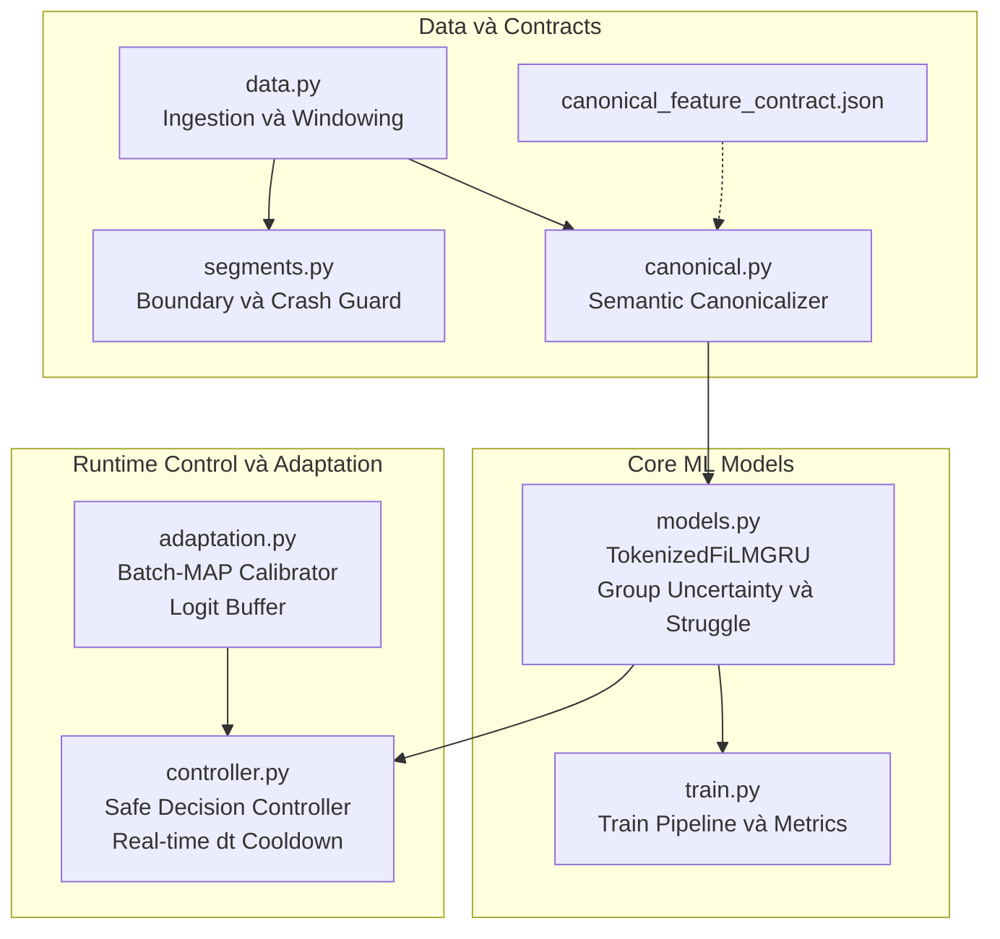

- **`canonical.py`**: Định nghĩa 21 đặc trưng ngữ nghĩa chuẩn, hàm tính toán delta độ khó `normalized_log_ratio_delta`, bộ chuẩn hóa thời gian thực `CausalSessionNormalizer` (kèm số hạng phương sai hỗn hợp), và hàm mô phỏng mất dữ liệu `masked_feature_dropout`.
- **`segments.py`**: Thiết lập ranh giới định thời của phân đoạn trò chơi (`EVENT_BOUNDED` cho wave/checkpoint hoặc `FIXED_HORIZON` cho game sinh tồn liên tục) và cung cấp cơ chế bảo vệ chống ngắt kết nối đột ngột (`allow_horizon_fallback`).
- **`data.py`**: Chịu trách nhiệm nạp dữ liệu thô (`load_session`), kiểm tra tính hợp lệ của schema, trích xuất đặc trưng phái sinh (`add_derived_features`), trượt cửa sổ thời gian 60s (`build_window_rows`) với bộ lọc phân biệt rạch ròi giữa gãy chuỗi thời gian (temporal gap) và vắng mặt đặc trưng (feature unavailability), tích hợp biến phi-đặc-thù `normalized_segment_index`.
- **`models.py`**: Triển khai các mô hình dự báo xác suất thành công:
  - `MajorityModel`: Baseline xác suất tiên nghiệm.
  - `NumpyLogisticRegression`: Baseline hồi quy Logistic thuần numpy (zero external dependencies).
  - `CandidateConditionedGRU`: Mô hình GRU v1 nối trực tiếp context và difficulty.
  - `TokenizedFiLMGRU`: Kiến trúc cốt lõi v2 với Feature Tokenization, Masked Gated Pooling (`clamp_min(1e-6)`), GRU Temporal Backbone và FiLM Difficulty Conditioning 10 chiều.
  - `estimate_mask_uncertainty`: Ước lượng độ bất định nhận thức (epistemic uncertainty) có trọng số nhóm (Group-Weighted Coverage, $25\%$ cho mỗi nhóm nghiệp vụ).
  - `estimate_struggle_probability`: Ước lượng xác suất người chơi gặp khó khăn nghiêm trọng (Heuristic Struggle Estimator) dựa trên $p(d_{\text{current}})$ và kiểm tra cờ khả dụng của lịch sử thắng (`win_rate_available`).
  - `export_tokenized_onnx`: Xuất mô hình sang định dạng ONNX static-shape với tham số mặc định 10 chiều độ khó.
- **`adaptation.py`**: Chứa `OnlineTemperatureCalibrator`, sử dụng phương pháp suy diễn Bayes MAP để hiệu chỉnh nhiệt độ theo từng mẻ (batch) lưu trực tiếp logit trong buffer sau khi quan sát được kết quả thực tế của phân đoạn, loại trừ rủi ro mất chính xác số học.
- **`controller.py`**: Chứa `ControllerState` và hàm `decide`, thực thi thuật toán ra quyết định thay đổi độ khó dựa trên xác suất hiệu chuẩn, trừ phạt độ bất định (uncertainty penalty), trừ phạt chi phí thay đổi (change penalty), và áp dụng các chốt an toàn nghiêm ngặt (cooldown theo thời gian thực `dt_seconds`, hysteresis streaks, safe checkpoint).
- **`train.py`**: Cung cấp pipeline phân chia dữ liệu độc lập theo người chơi (`group_split`), hàm tổng hợp đặc trưng thống kê (`aggregate_history`), tính toán toàn diện các chỉ số (Brier score, Log Loss, Accuracy, ECE, ROC-AUC, PR-AUC), và xuất bản model artifacts.

---

## 3. KIẾN TRÚC TỔNG THỂ HỆ THỐNG

### 3.1. Sơ đồ kiến trúc phân tầng (Layered Architecture)

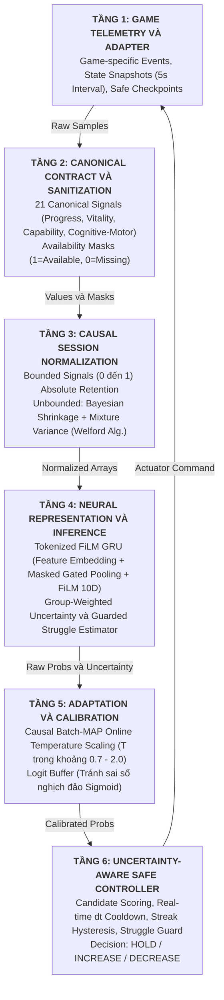

### 3.2. Chu trình thời gian thực (Online Closed-Loop Control)


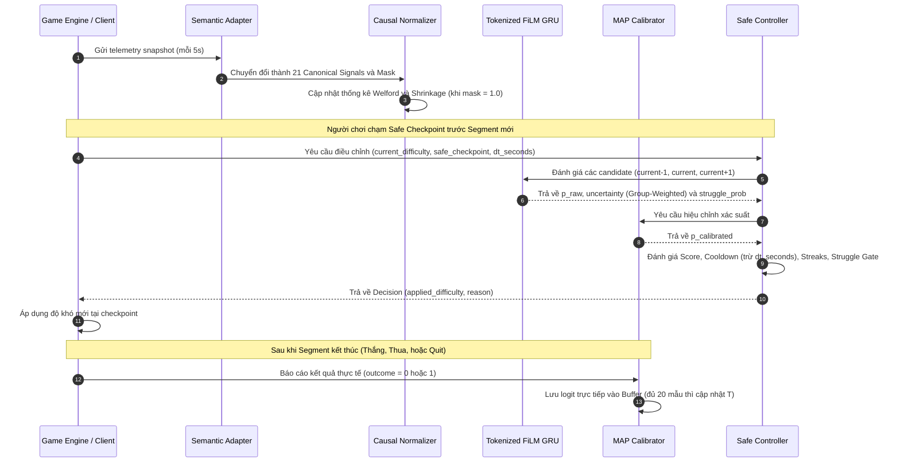

### 3.3. Pipeline huấn luyện ngoại tuyến (Offline Training Pipeline)

```mermaid
flowchart LR
    A["Raw Session Logs<br/>(JSON / Parquet)"] --> B["normalize_snapshot_frame()<br/>+ add_derived_features()<br/>normalized_segment_index"]
    B --> C["build_window_rows()<br/>Sequence: 12 snapshots x 5s<br/>Filter: Temporal Gap tối đa 35%"]
    C --> D["build_tokenized_window_rows()<br/>+ load_tokenized_window_dataset()<br/>Values (N, 12, 21), Mask (N, 12, 21)<br/>Difficulty (N, 10), Labels (N)"]
    D --> E["group_split()<br/>Player-disjoint Split<br/>(Train 70%, Val 15%, Test 15%)"]
    E --> F["train_tokenized_film_gru()<br/>BCEWithLogitsLoss, Adam<br/>Static-Shape Graph"]
    F --> G["Evaluation và Hardening<br/>Brier, ECE, PR-AUC<br/>Feature Dropout Robustness"]
    G --> H["Artifacts Export<br/>.pt Weights, split_manifest.json<br/>metrics.json, ONNX Sentis Model (10D)"]
```

---

## 4. THIẾT KẾ CHI TIẾT TỪNG PHÂN HỆ

### 4.1. Phân hệ Telemetry Ingestion & Windowing (`data.py`, `segments.py`)

#### a. Chuẩn hóa mẫu sự kiện thô (`normalize_snapshot_frame`)
- Hàm nhận một session JSON chứa mảng các `samples`.
- Hỗ trợ tương thích ngược: tự động ánh xạ `matchId` thành `sessionId` nếu thiếu trường này.
- Tính toán trục thời gian chuẩn hóa: `elapsed_seconds` tính từ `startedAtUtc` (hoặc `elapsedRealSeconds`).
- Loại bỏ các mẫu trùng lặp thời gian hoặc sự kiện trùng lặp (`drop_duplicates`).
- Trích xuất các chỉ số vật lý/kinh tế nền tảng: `hp_ratio = hp / hpMax`, `gold`, `tower_count`, `enemies_leaked`.
- **Trích xuất `segment_index`**: Tự động nhận diện từ `segmentIndex`, hoặc giải mã từ `segment_id` (nếu là số hoặc factorize), hoặc fallback về `wave`.
- **Nguyên tắc vàng**: Tuyệt đối không nội suy (interpolate) sự kiện giả. Những trường không xuất hiện trong nhật ký được giữ nguyên giá trị `NaN` để phân hệ canonical gắn mask $0$.

#### b. Trích xuất đặc trưng động học thời gian (`add_derived_features`)
Phân hệ tính toán các biến thiên tức thời dựa trên khoảng cách thời gian thực giữa 2 snapshot liên tiếp ($\Delta t$):
- Vận tốc hoàn thành: $v_{\text{progress}} = \frac{\Delta \text{progress\_ratio}}{\Delta t}$.
- Tốc độ mất máu: $r_{\text{hp\_loss}} = \frac{\max(0, -\Delta \text{hp\_ratio})}{\Delta t}$.
- Tốc độ tiêu vàng: $r_{\text{gold\_spend}} = \frac{\max(0, -\Delta \text{gold})}{\Delta t}$.
- Tốc độ xây tháp: $r_{\text{tower\_build}} = \frac{\max(0, \Delta \text{tower\_count})}{\Delta t}$.
- Tốc độ rò rỉ quái (Error slope): $\text{error\_slope} = \frac{\Delta \text{enemy\_leaks\_30s}}{\Delta t}$.
- **Vị trí phân đoạn phi-đặc-thù (Domain-Invariant Segment Index)**:
  $$\text{normalized\_segment\_index} = \text{clip}\left(\frac{\text{segment\_index}}{\text{total\_segments}}, 0.0, 1.0\right)$$
  Thay thế hoàn toàn chỉ số `wave_normalized` đặc thù của Tower Defense, giúp mô hình hoạt động ổn định khi chuyển sang Map có số lượng phân đoạn khác nhau hoặc các thể loại game khác.

#### c. Tạo cửa sổ trượt phân tích (`build_window_rows`)
- **Độ dài cửa sổ (Sequence Length)**: 12 snapshots tương ứng đúng 60 giây lịch sử quan sát ($12 \times 5s$).
- **Bước nhảy (Stride)**: 3 snapshots (15 giây) để tăng cường dữ liệu mẫu có độ gối đầu hợp lý.
- **Bộ lọc thiếu dữ liệu phân tầng (Two-Tier Missing Data Filter)**:
  1. *Thiếu theo chiều đặc trưng (Feature Unavailability / Dropout)*: Các feature vắng mặt toàn bộ trong game mới (hoặc bị cố ý che trong bài kiểm tra Benchmark B) được giữ nguyên để đưa vào mô hình với `mask = 0`.
  2. *Thiếu theo trục thời gian (Temporal Gap / Data Quality)*: Chỉ tính tỷ lệ NaN trên tập các đặc trưng có ít nhất một giá trị quan sát được trong cửa sổ:
     ```python
     available_features = [f for f in features if window[f].notna().any()]
     if len(available_features) < 5:
         continue
     if window[available_features].isna().mean().mean() > 0.35:
         continue
     ```
     Điều này bảo đảm không loại bỏ nhầm dữ liệu của game mới chỉ vì thiếu nhóm tín hiệu, đồng thời vẫn loại trừ các cửa sổ bị đứt gãy kết nối mạng/mất snapshot nghiêm trọng ($> 35\%$).
- **Vector ngữ cảnh**: Lưu trữ `context_json` gồm các biến phi-đặc-thù: `["progress_ratio", "normalized_segment_index", "current_difficulty"]`.
- **Gán nhãn**: Mỗi cửa sổ chỉ nhận nhãn `segment_success` thuộc về phân đoạn tương lai sau thời điểm kết thúc cửa sổ. Nghiêm cấm việc lấy kết quả chung cuộc của ván đấu (`match result = Won/Lost`) gán đồng loạt cho mọi snapshot.

---

### 4.2. Phân hệ Chuẩn hóa Ngữ nghĩa Toàn cục (`canonical.py`, `canonical_feature_contract.json`)

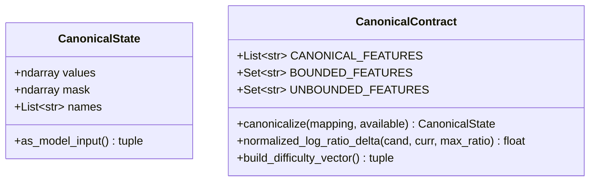

#### a. Cơ chế Canonicalize & Missing Mask
Hàm `canonicalize` biến đổi một dictionary đặc trưng đầu vào thành đối tượng `CanonicalState`:
- Nếu đặc trưng có mặt và là giá trị hữu hạn (`isfinite`): `value = float(x)`, `mask = 1.0`.
- Nếu đặc trưng vắng mặt (None, NaN, hoặc `available[name] == False`): `value = 0.0`, `mask = 0.0`.
- **Ý nghĩa sống còn**: Giá trị `0.0` đi kèm `mask = 0.0` là "placeholder" biểu thị dữ liệu bị khuyết, hoàn toàn khác biệt với giá trị `0.0` đi kèm `mask = 1.0` (ví dụ: máu thực sự bằng 0, hoặc tốc độ rò quái thực sự bằng 0).

#### b. Hợp đồng biến thiên độ khó log-ratio chuẩn hóa
Độ khó ứng viên được chuyển đổi thông qua công thức chuẩn hóa log-ratio:

$$\Delta_{\text{difficulty}} = \text{clip}\left(\frac{\ln(\text{param}_{\text{candidate}} / \text{param}_{\text{current}})}{\ln(\text{max\_step\_ratio})}, -1.0, 1.0\right)$$

- Bảo đảm tính đối xứng và invariant với đơn vị đo.
- Giá trị luôn bị chặn nghiêm ngặt trong khoảng $[-1, 1]$.
- Đối với `empirical_prior`: Chỉ được kích hoạt (`mask = 1.0`) nếu được trích xuất từ dữ liệu randomized fixed-difficulty trên cùng domain/patch. Nếu chạy cross-map hoặc zero-shot, giá trị này bắt buộc phải có `mask = 0.0`.
- Vector độ khó đưa vào mô hình gồm 10 chiều (`5 giá trị delta + 5 giá trị mask`).

---

### 4.3. Phân hệ Biểu diễn Đặc trưng Thời gian thực (`CausalSessionNormalizer`)

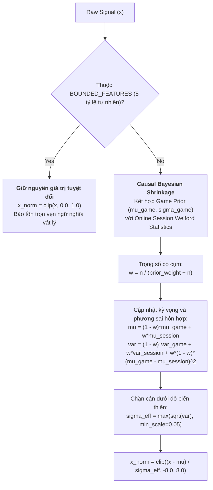

#### Các nguyên lý bảo vệ quan trọng:
1. **Bảo tồn ngữ nghĩa tuyệt đối (Bounded Feature Preservation)**: Chỉ có 5 tỷ lệ thực sự bị giới hạn $[0, 1]$ được giữ nguyên: `progress_ratio`, `vitality_ratio`, `invalid_action_rate`, `idle_ratio`, `recent_segment_win_rate`.
   - `time_budget_ratio` được chuyển sang nhóm **Unbounded** vì trong thực tế các ván chơi có thể bị bù giờ/quá giờ (`elapsed / expected > 1.0`).
   - `difficulty_adjusted_win_rate` có miền giá trị tự nhiên $[-1.0, 1.0]$ nên được chuẩn hóa shrinkage, tránh bị clip cụt mất phần giá trị âm.
2. **Causal Welford Algorithm**: Thống kê trung bình và phương sai online ($\mu_{\text{session}}, \sigma_{\text{session}}^2$) **chỉ được cập nhật khi `mask == 1.0`**. Tuyệt đối không đưa giá trị placeholder $0.0$ vào Welford khi dữ liệu bị khuyết.
3. **Số hạng phương sai hỗn hợp (Mixture Variance Cross-Term)**:
   $$\sigma^2 = (1 - w)\sigma_{\text{game}}^2 + w\sigma_{\text{session}}^2 + w(1 - w)(\mu_{\text{game}} - \mu_{\text{session}})^2$$
   Số hạng $w(1 - w)(\mu_{\text{game}} - \mu_{\text{session}})^2$ giúp độ co giãn $\sigma$ phản ánh chính xác độ bất định khi trình độ người chơi chênh lệch đáng kể so với mặt bằng chung toàn game.
4. **Scale Floor chống chia cho 0**: Cận dưới $\sigma_{\text{min}} = 0.05$ ngăn chặn việc nổ gradient.

---

### 4.4. Phân hệ Mô hình Học sâu: Tokenized FiLM GRU (`models.py`)

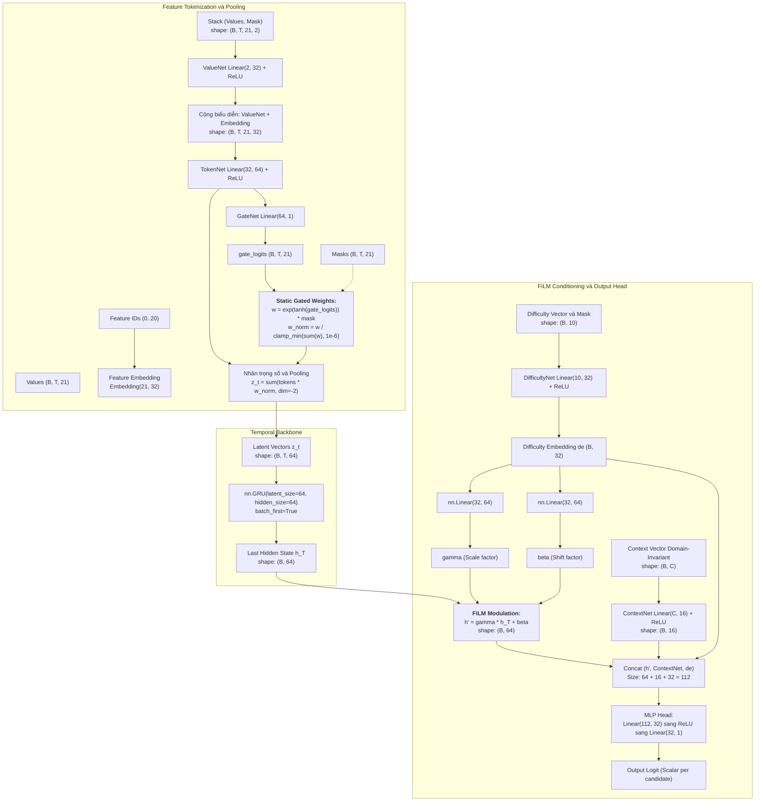

#### Phân tích chi tiết các khối kiến trúc:
1. **Tokenization phân giải kênh đặc trưng (Per-Feature Tokenizer)**:
   - Mỗi đặc trưng $i \in \{0, \dots, 20\}$ tại timestep $t$ được đại diện bởi bộ ba: `(feature_id, normalized_value, mask)`.
   - `feature_embedding` gán cho mỗi loại tín hiệu một vector ngữ nghĩa 32 chiều cố định.
   - `value_net` nhận vector 2 chiều `[value, mask]`, chiếu lên không gian 32 chiều.
2. **Cơ chế Masked Gated Pooling tĩnh (Static-Shape Friendly Pooling)**:
   - Sử dụng hàm kích hoạt: $\text{weights} = \exp(\tanh(\text{gate\_logits})) \times \text{mask}$.
   - Chuẩn hóa: $\text{weights}_{\text{norm}} = \frac{\text{weights}}{\max\left(\sum \text{weights}, 10^{-6}\right)}$.
   - Sử dụng cận dưới $10^{-6}$ (`clamp_min(1e-6)`) thay vì $1.0$ bảo đảm khi chỉ có 1 hoặc 2 đặc trưng khả dụng, tổng trọng số của chúng vẫn chuẩn hóa chính xác về $1.0$, không làm teo biên độ của vector latent $z_t$.
3. **Điều chế tham số FiLM (Feature-wise Linear Modulation)**:
   - Nhận vector độ khó **10 chiều** (`5 giá trị delta + 5 giá trị mask`):
     $$\gamma = \text{Gamma}(d), \quad \beta = \text{Beta}(d), \quad h' = \gamma \odot h_T + \beta$$
4. **Cơ chế ước lượng Uncertainty & Struggle chuẩn hóa**:
   - **`estimate_mask_uncertainty(mask, base_uncertainty=0.05)`**:
     Thay vì tính trung bình phẳng trên 21 biến (dễ bị phạt oan đầu trận khi thiếu 3 biến lịch sử khiến $\text{coverage} = 85.7\% < 88.9\%$, gây khóa cứng DDA), hàm tính **độ phủ có trọng số nhóm (Group-Weighted Coverage)** qua 4 nhóm nghiệp vụ (mỗi nhóm chiếm $25\%$ trọng số):
     $$\text{coverage} = 0.25 \cdot c_{\text{progress}} + 0.25 \cdot c_{\text{vitality}} + 0.25 \cdot c_{\text{capability}} + 0.25 \cdot c_{\text{motor}}$$
     $$\mathcal{U} = u_{\text{base}} + (1 - \text{coverage}) \cdot (1 - u_{\text{base}}), \quad u_{\text{base}} = 0.05$$
     - *Đầu trận bình thường (thiếu 3 biến motor)*: $\text{coverage} = 0.25 \times (3 + 6/9) = 91.67\% \implies \mathcal{U} = 0.1292 \implies \text{Confidence} = 0.8708 \ge 0.80$ (Controller hoạt động bình thường, không bị đóng băng!).
     - *Mất hẳn 1 nhóm sinh tồn (Benchmark B)*: $\text{coverage} = 0.25 \times 3 = 75\% \implies \mathcal{U} = 0.2875 \implies \text{Confidence} = 0.7125 < 0.80 \implies$ Kích hoạt `HOLD_LOW_CONFIDENCE` chuẩn xác.
   - **`estimate_struggle_probability(probabilities, current_difficulty, recent_win_rate, win_rate_available)`**:
     Là một **Heuristic Struggle Estimator** (rule-based/heuristic inference component) dựa trên xác suất dự báo và lịch sử thắng:
     $$P_{\text{struggle}} = \begin{cases} 1.0 - p(d_{\text{current}}), & \text{khi } \text{win\_rate chưa khả dụng (đầu trận, mask = 0)} \\ 0.6 \cdot (1.0 - p(d_{\text{current}})) + 0.4 \cdot (1.0 - \text{recent\_win\_rate}), & \text{khi } \text{win\_rate khả dụng (mask = 1)} \end{cases}$$
     - Sử dụng trực tiếp $p(d_{\text{current}})$ thay cho trung bình $\bar{p}$ nhằm phản ánh đúng độ chật vật ở mức hiện tại, không bị làm mờ bởi candidate dễ hơn có xác suất cao.
     - Kiểm tra `win_rate_available` để ngăn chặn việc lấy giá trị placeholder `0.0` làm tăng đột biến $0.40$ điểm và gây hạ độ khó oan ở wave đầu tiên.

---

### 4.5. Phân hệ Hiệu chỉnh Online: Batch-MAP Temperature Scaling (`adaptation.py`)

$$P_{\text{calibrated}} = \sigma\left(\frac{\text{logit}}{T}\right) = \frac{1}{1 + \exp\left(-\frac{\text{logit}}{T}\right)}$$

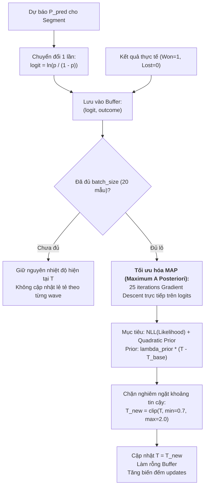

#### Các nguyên tắc an toàn cốt lõi:
- **Lưu trữ trực tiếp Logit**: Buffer lưu cặp `(logit, outcome)` thay vì `(probability, outcome)`. Điều này loại bỏ hoàn toàn việc tính toán nghịch đảo hàm sigmoid $\ln(p / (1-p))$ trong vòng lặp tối ưu, ngăn ngừa lỗi mất độ chính xác số học khi $p \to 0$ hoặc $p \to 1$.
- **Cập nhật theo lô (Batch, Not Per-Wave)**: Mỗi 20 kết quả mới kích hoạt một update; tối ưu trên sliding window tối đa 60 kết quả gần nhất.
- **Tiên nghiệm co cụm bậc hai (Quadratic MAP Prior)**: Thành phần phạt $\frac{1}{2} \lambda_{\text{prior}} (T - T_{\text{base}})^2$ luôn kéo $T$ về lại giá trị chuẩn $1.0$.
- **Biên giới hạn cứng**: Nhiệt độ chỉ được phép dao động trong đoạn $[0.7, 2.0]$.

---

### 4.6. Phân hệ Điều khiển An toàn Đa tầng (`controller.py`)

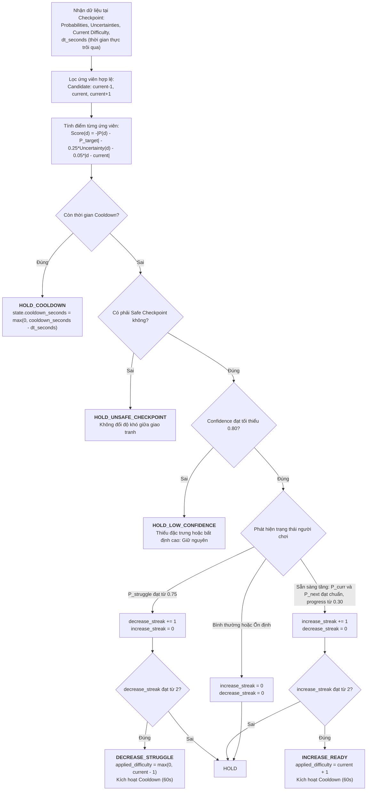

#### Ma trận quy tắc ra quyết định:
1. **Hàm tính điểm ứng viên (Candidate Scoring Function)**:
   $$\text{Score}(d) = - |P(d) - P_{\text{target}}| - \lambda_{\text{uncertainty}} \cdot \mathcal{U}(d) - \lambda_{\text{change}} \cdot |d - d_{\text{current}}|$$
   - Phạt độ lệch khỏi mục tiêu dòng chảy tâm lý ($P_{\text{target}} = 0.70$).
   - Phạt độ bất định mô hình ($\lambda_{\text{uncertainty}} = 0.25$).
   - Phạt chi phí thay đổi để chống dao động vặt ($\lambda_{\text{change}} = 0.05$).
2. **Thời gian hồi theo thời gian thực (`dt_seconds`)**:
   `state.cooldown_seconds = max(0.0, state.cooldown_seconds - dt_seconds)`.
   Người gọi truyền số giây thực tế trôi qua giữa hai lần đánh giá. Khi checkpoint cách nhau 30–60s, cooldown 60s sẽ kết thúc chính xác sau 1 đến 2 checkpoint thay vì bị kéo giãn thành 30–60 phút như khi trừ cứng $1.0$.
3. **Chốt an toàn điểm dừng (Safe Checkpoint Gate)**: Chỉ cho phép thay đổi độ khó giữa các wave, trong phòng chờ hoặc tại điểm hồi sinh.
4. **Chốt bất định (Uncertainty Gate)**: Nếu thiếu quá nhiều telemetry khiến độ tự tin tổng thể $< 0.80$, hệ thống tự động khóa ở trạng thái `HOLD_LOW_CONFIDENCE`.
5. **Cơ chế Hysteresis Streaks (Trễ chống rung lắc)**: Cần ít nhất 2 chu kỳ liên tiếp thỏa mãn điều kiện thì quyết định tăng/giảm mới được kích hoạt.

---

## 5. QUY CHUẨN DỮ LIỆU & HỢP ĐỒNG GIAO TIẾP

### 5.1. Bảng 21 Đặc trưng Ngữ nghĩa Canonical (Canonical Signals)

Theo đặc tả trong `canonical_feature_contract.json`:

| STT | Tên tín hiệu Canonical | Nhóm nghiệp vụ | Bounded? | Ý nghĩa ngữ nghĩa & Quy chuẩn chuẩn hóa |
|:---:|---|---|:---:|---|
| 1 | `progress_ratio` | `progress_tempo` | **Có** $[0,1]$ | Tiến độ hoàn thành wave/phân đoạn hiện tại. Giữ nguyên giá trị tuyệt đối. |
| 2 | `progress_velocity` | `progress_tempo` | Không | Vận tốc hoàn thành tiến độ trên giây ($\Delta \text{progress} / \Delta t$). Shrinkage. |
| 3 | `time_budget_ratio` | `progress_tempo` | Không | Tỷ lệ thời gian đã dùng so với dự kiến. Chuẩn hóa Shrinkage (có thể $> 1.0$ khi bù giờ). |
| 4 | `tempo_rate` | `progress_tempo` | Không | Nhịp độ sự kiện hoặc tần số xuất hiện mục tiêu/quái trên giây. Shrinkage. |
| 5 | `vitality_ratio` | `vitality_error` | **Có** $[0,1]$ | Tỷ lệ máu, giáp hoặc mạng còn lại so với mức tối đa. Giữ nguyên giá trị. |
| 6 | `vitality_loss_rate` | `vitality_error` | Không | Tốc độ hao hụt sinh lực trên giây. Shrinkage. |
| 7 | `critical_error_rate` | `vitality_error` | Không | Tần suất mắc sai lầm nghiêm trọng (để quái lọt, dính đòn chí mạng) trên giây. |
| 8 | `failure_cost_ratio` | `vitality_error` | Không | Tỷ lệ tiến độ hoặc tài nguyên bị tổn thất trực tiếp sau các sai sót. |
| 9 | `resource_reserve_ratio` | `capability_economy` | Không | Lượng tài nguyên dự trữ so với chi phí của một hành động chuẩn. |
| 10 | `resource_utilization_rate`| `capability_economy` | Không | Tốc độ chuyển hóa tài nguyên thành năng lực chiến đấu (mua sắm, nâng cấp). |
| 11 | `capability_ratio` | `capability_economy` | Không | Sức mạnh hỏa lực/trang bị hiện tại so với ngưỡng yêu cầu chuẩn của segment. |
| 12 | `threat_pressure_ratio` | `capability_economy` | Không | Áp lực đe dọa từ phía môi trường/kẻ địch đối với người chơi. |
| 13 | `action_frequency` | `human_cognitive_motor`| Không | Số hành động có ý nghĩa (meaningful actions/APM) thực hiện trên giây. |
| 14 | `invalid_action_rate` | `human_cognitive_motor`| **Có** $[0,1]$ | Tỷ lệ thao tác lỗi, bấm trượt, lệnh không hợp lệ so với tổng số thao tác. |
| 15 | `idle_ratio` | `human_cognitive_motor`| **Có** $[0,1]$ | Tỷ lệ thời gian người chơi không có thao tác điều khiển nào. |
| 16 | `reaction_latency` | `human_cognitive_motor`| Không | Độ trễ phản xạ (giây) từ khi xuất hiện kích thích đến khi phát sinh phản ứng. |
| 17 | `error_slope` | `human_cognitive_motor`| Không | Gia tốc phát sinh sai lầm (đạo hàm của tỷ lệ lỗi theo thời gian). |
| 18 | `recent_segment_win_rate` | `human_cognitive_motor`| **Có** $[0,1]$ | Tỷ lệ thắng gần đây. Ở đầu trận (chưa có segment), gắn `mask = 0`. |
| 19 | `recent_average_difficulty`| `human_cognitive_motor`| Không | Mức độ khó trung bình người chơi đã trải qua trong các phân đoạn gần nhất. |
| 20 | `difficulty_adjusted_win_rate`| `human_cognitive_motor`| Không | Hiệu số giữa tỷ lệ thắng gần đây và prior (miền $[-1, 1]$). Shrinkage. Mask=0 nếu không có prior. |
| 21 | `efficiency_ratio` | `human_cognitive_motor`| Không | Tỷ số giữa hiệu quả đầu ra (sát thương, tiến độ) trên chi phí thao tác đầu vào. |

### 5.2. Biểu diễn Không gian Độ khó Liên tục (Continuous Difficulty Representation)

Vector độ khó đầu vào mô hình gồm **10 chiều** (`5 giá trị + 5 mask`):
```text
Giá trị (Indices 0..4):
  Index 0: relative_step       ∈ [-1.0, 1.0]   (Bước nhảy tương đối so với mức hiện tại)
  Index 1: pressure_delta      ∈ [-1.0, 1.0]   (Độ biến thiên áp lực kẻ địch theo hàm log-ratio)
  Index 2: forgiveness_delta   ∈ [-1.0, 1.0]   (Độ biến thiên lượng thứ sai sót/hỗ trợ người chơi)
  Index 3: resource_delta      ∈ [-1.0, 1.0]   (Độ biến thiên tiếp tế tài nguyên/hồi phục)
  Index 4: empirical_prior     ∈ [ 0.0, 1.0]   (Xác suất thắng tiên nghiệm lịch sử nếu có)

Mặt nạ hợp lệ (Indices 5..9):
  Index 5..8: mask cho relative_step, pressure, forgiveness, resource (luôn = 1.0)
  Index 9:    mask cho empirical_prior (chỉ = 1.0 nếu từ same domain/patch; = 0.0 nếu zero-shot)
```

### 5.3. Hợp đồng Phân đoạn Game (Segment Contract & Crash-Safe Guard)

Module `segments.py` quy định hai hình thái phân đoạn:
1. `SegmentMode.EVENT_BOUNDED`: Phân đoạn có sự kiện đóng mở rõ ràng (Wave, Room, Checkpoint). Ranh giới chuẩn 30–60 giây.
2. `SegmentMode.FIXED_HORIZON`: Phân đoạn định thời cố định dành cho game thế giới mở hoặc sinh tồn liên tục (cửa sổ sinh tồn 30 giây).

Hàm tính ranh giới tích hợp **Crash-Safe Guard**:
```python
def segment_boundary(mode: SegmentMode, decision_time: float, horizon_seconds: float,
                     event_finish_time: float | None = None,
                     allow_horizon_fallback: bool = False) -> tuple[float, float]:
    """Return [start, end] boundary used by feature/label generation.

    Guarantees returning a non-None, strictly finite tuple[float, float].
    If an event-bounded segment experiences unexpected disconnect/crash
    (event_finish_time is None), allow_horizon_fallback enables gracefully
    falling back to decision_time + horizon_seconds instead of raising or returning None.
    """
    if mode == SegmentMode.EVENT_BOUNDED:
        if event_finish_time is not None and event_finish_time > decision_time:
            return float(decision_time), float(event_finish_time)
        if allow_horizon_fallback and horizon_seconds > 0:
            return float(decision_time), float(decision_time + horizon_seconds)
        raise ValueError("event-bounded segment needs a valid finish event after decision; session may have disconnected prematurely")
    if horizon_seconds <= 0:
        raise ValueError("fixed horizon must be positive")
    return float(decision_time), float(decision_time + horizon_seconds)
```

---

## 6. CƠ CHẾ BẢO ĐẢM TÍNH TOÀN VẸN & CHỐNG RÒ RỈ DỮ LIỆU

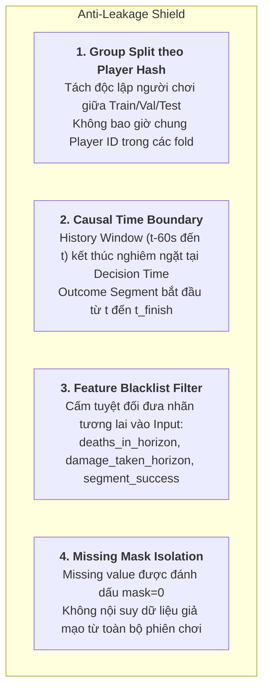

1. **Phân chia độc lập theo Người chơi (`group_split`)**:
   - Sử dụng `player_id_hash` làm khóa nhóm (fallback về `session_id`).
   - Tuyệt đối không xáo trộn ngẫu nhiên từng dòng snapshot.
2. **Cô lập ranh giới nhân quả (Causal Boundary Isolation)**:
   - Cửa sổ quan sát lịch sử $[t - 60s, t]$ kết thúc chính xác tại thời điểm ra quyết định $t$.
   - Nhãn kết quả phân đoạn chỉ được ghi nhận từ các sự kiện xảy ra trong khoảng $[t, t_{\text{finish}}]$.
3. **Danh mục cấm đặc trưng (Banned Features)**:
   - Các biến số tương lai như `deaths_in_horizon`, `damage_taken_horizon`, và trạng thái thắng cuộc toàn ván (`match_result = Won`) bị cấm hoàn toàn trong không gian đặc trưng đầu vào.
4. **Bộ chuẩn hóa thuần Causal**:
   - `CausalSessionNormalizer` chỉ tích lũy giá trị các snapshot từ thời điểm bắt đầu trận đấu đến thời điểm hiện tại $t$, không sử dụng trung bình/phương sai của toàn bộ ván đấu để chuẩn hóa các snapshot ban đầu.

---

## 7. ĐÁNH GIÁ HIỆU NĂNG & KHUNG THỬ NGHIỆM NGHIÊN CỨU

### 7.1. Hệ thống chỉ số đánh giá (Evaluation Metrics)

- **Brier Score**: $\text{Brier} = \frac{1}{N} \sum_{i=1}^N (P_i - y_i)^2$ (đo sai số bình phương trung bình).
- **Expected Calibration Error (ECE)**: $\text{ECE} = \sum_{m=1}^{M} \frac{|B_m|}{N} \left| \text{acc}(B_m) - \text{conf}(B_m) \right|$ (đo độ tin cậy của xác suất).
- **PR-AUC (Precision-Recall AUC)** & **ROC-AUC**: Đo năng lực phân loại trên tập dữ liệu mất cân bằng.
- **Log Loss (Binary Cross-Entropy)**: Phạt rất nặng các dự báo quá tự tin nhưng sai sót.

### 7.2. Các kịch bản thực nghiệm cốt lõi

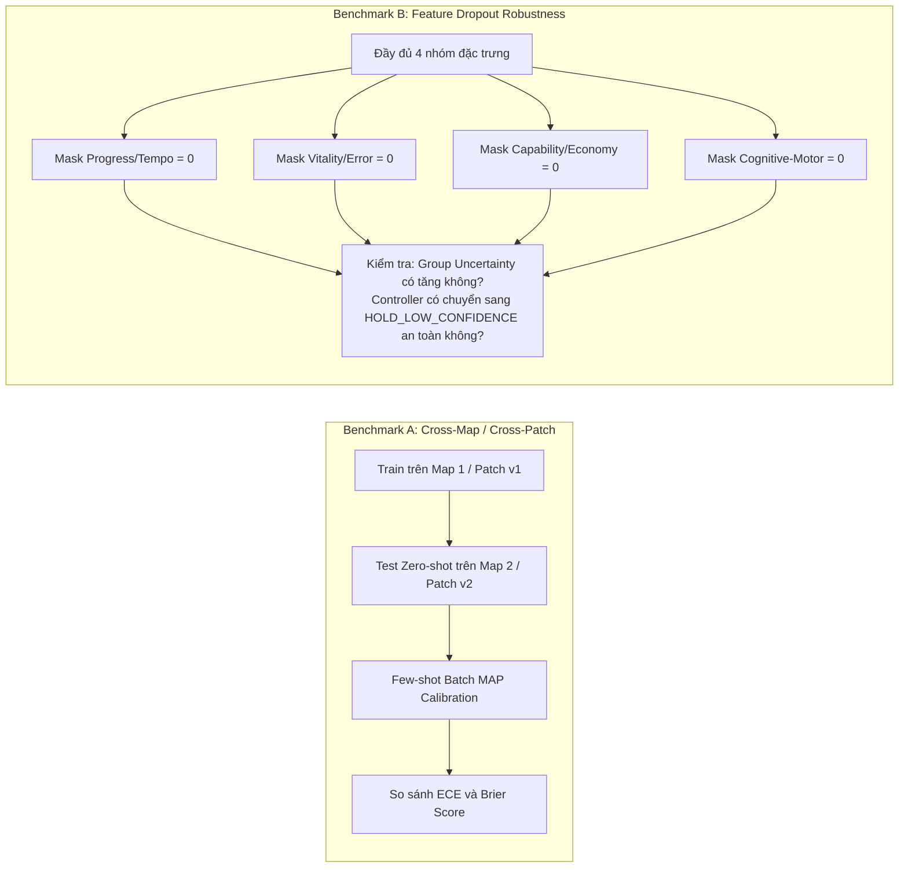

1. **Thực nghiệm A — Khả năng khái quát hóa Cross-Map / Cross-Patch**:
   - Huấn luyện mô hình thuần túy trên dữ liệu Map 1 (hoặc Patch cân bằng cũ).
   - Đánh giá không đổi trọng số (zero-shot) trên Map 2 (hoặc Patch cân bằng mới).
   - Đo lường mức độ cải thiện của `TokenizedFiLMGRU` kết hợp `OnlineTemperatureCalibrator` so với baseline `Static CandidateGRU`.
2. **Thực nghiệm B — Khả năng chống chịu rụng đặc trưng (Feature Dropout Robustness)**:
   - Che lần lượt từng nhóm trong 4 nhóm đặc trưng canonical bằng hàm `masked_feature_dropout`.
   - Tiêu chí đánh giá: Mô hình không được crash; độ bất định nhóm tăng lên tương ứng (`estimate_mask_uncertainty`); và Controller phải kích hoạt chốt giữ nguyên `HOLD_LOW_CONFIDENCE` thay vì tự ý nâng độ khó bừa bãi.

---

## 8. KHẢ NĂNG TÍCH HỢP GAME ENGINE (UNITY / ONNX SENTIS C# RUNTIME)

Mô hình học sâu được tối ưu hóa riêng cho việc biên dịch ONNX:

```python
def export_tokenized_onnx(model, output_path: str, sequence_length: int,
                          feature_count: int, context_count: int, difficulty_count: int = 10) -> None:
    """Export static-shape model for early Unity Sentis compatibility checks."""
    dummy = (
        torch.zeros(1, sequence_length, feature_count),    # values [1, 12, 21]
        torch.ones(1, sequence_length, feature_count),     # mask [1, 12, 21]
        torch.zeros(1, context_count),                     # context [1, C]
        torch.zeros(1, difficulty_count)                   # difficulty [1, 10] (values + mask)
    )
    torch.onnx.export(
        model, dummy, output_path,
        input_names=["values", "mask", "context", "difficulty"],
        output_names=["logit"],
        dynamic_axes=None,  # Static Shape bảo đảm tương thích tối đa với Unity Sentis
        opset_version=17
    )
```

### Kiến trúc phân chia trách nhiệm giữa ONNX Model và Unity C# Runtime:

Vì file `.onnx` chỉ đảm nhận phần suy luận mạng nơ-ron và xuất ra tensor `"logit"`, toàn bộ các thành phần thích ứng và điều khiển an toàn được thiết kế dưới dạng các hàm toán học ngắn gọn (lightweight logic) sẵn sàng ánh xạ sang Unity C# Runtime:

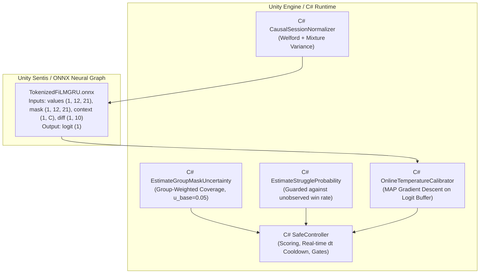

- **Static Tensor Shapes**: Cố định tensor đầu vào ($[1, 12, 21]$ và $[1, 10]$), cho phép Unity Sentis cấp phát bộ nhớ một lần duy nhất, không phát sinh Garbage Collection (Zero GC Alloc).
- **Loại bỏ MaskedFill(-inf)**: Thay thế bằng phép nhân mask tuyến tính và `clamp_min(1e-6)` giúp chạy mượt mà trên FP16, WebGL và mobile shader.

---

## 9. TỔNG KẾT ƯU ĐIỂM, RỦI RO & LỘ TRÌNH PHÁT TRIỂN

### 9.1. Điểm mạnh nổi bật của kiến trúc
1. **Thiết kế phân ly hoàn hảo (Decoupled Design)**: Tách biệt triệt để giữa đặc thù riêng của từng game (Telemetry Adapter) và logic AI tổng quát (Canonical Runtime & Controller).
2. **An toàn trải nghiệm (Safety First)**: Đặt sự ổn định và tâm lý người chơi lên hàng đầu với bộ điều khiển đa tầng (Real-time dt Cooldown, Hysteresis, Confidence threshold, Guarded struggle detector).
3. **Khả năng chịu lỗi cao (Robustness to Missing Data)**: Phân biệt bản chất giữa "dữ liệu bằng 0" và "dữ liệu bị thiếu" thông qua cơ chế Tokenized Masking và Group-Weighted Coverage.
4. **Sẵn sàng triển khai thực địa (Production-Ready)**: Không chỉ là mô hình lý thuyết, mã nguồn đi kèm đầy đủ module xuất ONNX 10D, kiểm thử đơn vị, và cơ chế hiệu chỉnh nhiệt độ thời gian thực.

### 9.2. Rủi ro kỹ thuật & Giới hạn hiện tại
1. **Dữ liệu mồi ban đầu**: Cần tối thiểu dữ liệu telemetry có gắn nhãn phân đoạn chất lượng cao từ logger mới để huấn luyện mô hình cơ sở. Dữ liệu thô thiếu nhãn segment sẽ không thể sử dụng.
2. **Chi phí xây dựng Adapter cho game mới**: Game mới vẫn đòi hỏi đội ngũ lập trình viên thiết kế Semantic Adapter để chuyển đổi đúng ngữ nghĩa sang 21 tín hiệu canonical.
3. **Giới hạn của Online Adaptation**: Hệ thống v2 mới chỉ cho phép thích ứng online ở tầng hiệu chuẩn nhiệt độ (Temperature MAP), chưa thực hiện online fine-tuning trọng số của mạng GRU trực tiếp trong lúc chơi (nhằm bảo đảm an toàn, tránh catastrophic forgetting).

### 9.3. Lộ trình phát triển đề xuất (Roadmap)
- **Giai đoạn tiếp theo (v2.5)**:
  - Tích hợp pipeline kiểm thử tự động benchmark Cross-Map trên Unity Editor thông qua giao thức IPC/Socket hoặc Unity Sentis runner.
  - Xây dựng bảng điều khiển trực quan hóa (Telemetry Dashboard) theo dõi trực tiếp xác suất $P(\text{success})$ và các quyết định của Controller theo thời gian thực.
- **Tương lai dài hạn (v3.0)**:
  - Khảo sát mô hình Contextual Bandit có ràng buộc an toàn (Constrained Contextual Bandits) cho bộ điều khiển policy thay cho rule-based heuristic.
  - Nghiên cứu Offline Reinforcement Learning (Conservative Q-Learning - CQL) để tối ưu hóa trực tiếp chỉ số lưu giữ người chơi (Player Retention) và thời lượng phiên chơi (Session Engagement).
