# PHÂN TÍCH KIẾN TRÚC HỆ THỐNG DDA-models v2
## Universal Runtime Contract & Adaptive Neural Framework

**Tài liệu đồng bộ với `report.md` (Cơ sở lý thuyết, định nghĩa và kiến thức chuyên sâu của DDA-models v2). Bản đối chiếu ba lớp: tài liệu lý thuyết ↔ đặc tả kiến trúc ↔ mã nguồn thực tế.**

---

## MỤC LỤC

0. [Quy ước đọc tài liệu](#0-quy-ước-đọc-tài-liệu)
1. [Tổng quan hệ thống](#1-tổng-quan-hệ-thống)
2. [Bản đồ mã nguồn](#2-bản-đồ-mã-nguồn)
3. [Kiến trúc tổng thể](#3-kiến-trúc-tổng-thể)
4. [Hợp đồng dữ liệu](#4-hợp-đồng-dữ-liệu)
5. [Chi tiết các phân hệ](#5-chi-tiết-các-phân-hệ)
6. [Toàn vẹn dữ liệu và tính đúng đắn nhân quả](#6-toàn-vẹn-dữ-liệu-và-tính-đúng-đắn-nhân-quả)
7. [Đánh giá và khung thực nghiệm](#7-đánh-giá-và-khung-thực-nghiệm)
8. [Tích hợp game engine (Unity / ONNX Sentis)](#8-tích-hợp-game-engine-unity--onnx-sentis)
9. [Tổng kết: điểm mạnh, rủi ro và lộ trình](#9-tổng-kết-điểm-mạnh-rủi-ro-và-lộ-trình)
10. [Phụ lục](#10-phụ-lục)

---

## 0. QUY ƯỚC ĐỌC TÀI LIỆU

### 0.1. Quan hệ với `report.md`

Hai tài liệu phục vụ hai mục đích khác nhau và **không được mâu thuẫn nhau**:

| Tài liệu | Trả lời câu hỏi | Độ sâu |
|---|---|---|
| `report.md` | *Vì sao* hệ thống đúng hoặc sai về lý thuyết, toán học, nhân quả, thống kê | Chứng minh, phản biện, giới hạn |
| Tài liệu này | *Hệ thống được lắp ráp như thế nào*, mô-đun nào làm gì, hợp đồng dữ liệu nào ràng buộc cái gì | Kiến trúc, luồng dữ liệu, giao diện, triển khai |

Nguyên tắc biên soạn: **mỗi khẳng định kỹ thuật phải truy vết được** tới (i) một mục trong `report.md`, (ii) một hằng số hoặc ngưỡng trong mã nguồn/config, hoặc (iii) một dòng trong danh sách cần xác minh (mục 10.3). Chỗ nào mã lệch đặc tả, tài liệu nêu cả hai.

### 0.2. Nhãn trạng thái (thống nhất với `report.md` §0.2)

| Nhãn | Ý nghĩa |
|---|---|
| **[Đã triển khai v2]** | Có trong đặc tả v2 và có mô-đun/hàm tương ứng. |
| **[Đã kiểm chứng trong mã]** | Giá trị hoặc hành vi đã được đọc trực tiếp từ mã nguồn trong bản rà soát này. |
| **[Khuyến nghị]** | Chưa có trong hệ thống nhưng cần có để đúng về lý thuyết hoặc kỹ thuật. |
| **[Mở rộng]** | Hướng ngoài phạm vi cam kết của v2. |
| **[Cần xác minh]** | Chưa xác định được từ đặc tả; cần đối chiếu thêm. |
| **[Thiếu trong mã]** | Đặc tả hoặc tài liệu cũ khẳng định có, nhưng mã nguồn hiện tại **không** có. |

### 0.3. Ký hiệu dùng trong tài liệu này

| Ký hiệu | Ý nghĩa | Giá trị / ghi chú |
|---|---|---|
| $s$, $k$, $t_k$ | Phiên chơi, chỉ số phân đoạn, thời điểm quyết định | — |
| $\Delta = 5$ s, $L = 12$ | Chu kỳ snapshot, độ dài cửa sổ | Cửa sổ bao phủ 60 s |
| $F = 21$, $C = 3$ | Số tín hiệu canonical, số chiều ngữ cảnh | — |
| $x_t$, $m_t$ | Vector giá trị, mặt nạ khả dụng | $m_t \in \{0,1\}^{F}$ |
| $d \in \mathbb{R}^{10}$ | Vector độ khó ứng viên | 5 giá trị + 5 mask |
| $\mathsf{D} \in \{0,\dots,D_{\max}\}$ | Chỉ số profile độ khó rời rạc | $D_{\max} = 4$ **[Đã kiểm chứng trong mã]** |
| $z$, $p = \sigma(z)$ | Logit thô, xác suất thô | — |
| $\tau$, $\beta = 1/\tau$ | Nhiệt độ hiệu chuẩn và nghịch đảo | $\tau \in [0.7, 2.0]$ |
| $P_{\text{target}}$ | Xác suất thành công mục tiêu | $0.70$ |
| $\mathcal{U}$, coverage | Bất định theo độ phủ đầu vào, độ phủ nhóm | xem §5.4 |
| $\kappa$ | `prior_weight` của normalizer | $10.0$ **[Đã kiểm chứng trong mã]** |

Mã nguồn dùng $T$ cho cả độ dài chuỗi và nhiệt độ. Tài liệu này theo `report.md`: $L$ cho độ dài chuỗi, $\tau$ cho nhiệt độ.

### 0.4. Nhật ký hiệu chỉnh của bản kiến trúc này

Bản trước có một số khẳng định **không khớp** với `report.md` hoặc với mã nguồn. Bảng dưới ghi lại từng chỗ đã sửa:

| # | Vị trí cũ | Vấn đề | Hiệu chỉnh |
|---|---|---|---|
| 1 | §4.4, §9.1 | Gọi độ phủ mặt nạ là *epistemic uncertainty* | Đổi thành **Input-Coverage Confidence**; epistemic thật cần ensemble/MC-Dropout (`report.md` §5.3) |
| 2 | §1.2, §4.6, §9.1 | Gọi cơ chế streak là *hysteresis* | Đổi thành **dead band + debouncing + lockout** (`report.md` §6.4) |
| 3 | §4.4 | `clamp_min(1e-6)` "giữ tổng trọng số bằng 1 khi chỉ có 1–2 đặc trưng" | Với $M_t \ge 1$, $\sum a \ge M_t e^{-1} \ge 0.368$ nên cận không kích hoạt; nó chỉ chống `NaN` khi $M_t = 0$ (`report.md` §4.3) |
| 4 | §4.5 | "Loại bỏ hoàn toàn phép nghịch đảo sigmoid" | `observe()` vẫn tính `logit = ln(p/(1-p))` một lần khi nạp buffer; cái bị loại là phép tính **lặp trong vòng tối ưu** |
| 5 | §1.1, §4.1 | Gọi $\mathcal{C}_t$ là *domain-invariant* | Chỉ là **canonical feature space**; `current_difficulty` và `normalized_segment_index` không bất biến giữa map/patch (`report.md` §2.2) |
| 6 | §7.1 | PR-AUC không nêu lớp dương | Lớp dương phải là **failure ($y=0$), score $1-p$**; mã hiện dùng success (`report.md` §5.1) |
| 7 | §3.3 | Pipeline vẽ `build_tokenized_window_rows()` | Hàm này **không tồn tại** trong `data.py`; chỉ có `load_tokenized_window_dataset()` đọc dữ liệu dựng sẵn |
| 8 | §8 | "Zero GC Alloc" như tính chất đã có | Là **mục tiêu thiết kế**, phải đo bằng Unity Profiler (`report.md` §8.1) |
| 9 | §8 | `opset_version=17` trình bày như đã tương thích | Là **rủi ro**: Sentis hỗ trợ opset 7–15 và toán tử `GRU` chưa được hỗ trợ |
| 10 | §4.5 | "Sliding window tối đa 60 mẫu" | Mã **xóa buffer** sau mỗi lần cập nhật; không có cửa sổ 60 |
| 11 | §4.6 | Ngưỡng "sẵn sàng tăng" để ngỏ | Mã xác nhận: $p(d_{\text{cur}}) \ge 0.70$ **và** $p(d_{\text{cur}}+1) \ge 0.70$ **và** `progress` $\ge 0.30$ |
| 12 | Toàn bộ | Không có ma trận đối chiếu report ↔ kiến trúc ↔ mã | Bổ sung Phụ lục 10.2 và 10.3 |

---

## 1. TỔNG QUAN HỆ THỐNG

### 1.1. Bài toán và đối tượng ước lượng

Hệ thống là một **bộ điều khiển độ khó vòng kín** dùng telemetry hành vi. Tại mỗi điểm quyết định $t_k$ (một safe checkpoint), hệ thống ước lượng xác suất thành công của phân đoạn kế tiếp **dưới một can thiệp độ khó cụ thể**:

$$\mu(h, c, d) \;=\; \Pr\!\big(Y_k = 1 \mid \mathcal{H}_{t_k}=h,\; c_{t_k}=c,\; \operatorname{do}(d_k = d)\big),$$

và xấp xỉ bằng $\sigma\big(f_\theta(h,c,d)\big)$ với $f_\theta$ là `TokenizedFiLMGRU`.

Ba điểm cần đọc đúng (theo `report.md` §1.2):

1. Đây là **dự báo can thiệp có điều kiện**. Nó chỉ là đại lượng nhân quả khi ba giả thiết (A1) nhất quán, (A2) hoán đổi được có điều kiện, (A3) positivity đều đúng (§6.3).
2. Với mỗi trạng thái, hệ thống truy vấn **ba ứng viên** $d^- = d_{\text{cur}}-1$, $d^0 = d_{\text{cur}}$, $d^+ = d_{\text{cur}}+1$ rồi mới so sánh. Đây là khác biệt cốt lõi so với DDA phân loại người chơi thành nhãn tĩnh.
3. Mạng có dạng *S-learner* (một mô hình, $d$ là một đầu vào). Rủi ro đặc trưng là điều chuẩn khiến mạng **bỏ qua $d$**, nên kiểm tra độ nhạy theo $d$ (§7.3, thực nghiệm C) là yêu cầu bắt buộc.

### 1.2. Vị trí trong phân loại DDA

`report.md` §1.1 chia bốn họ tiếp cận: rule-based, mô hình hiệu suất/xác suất, học tăng cường, và affect-based. **DDA-models thuộc họ thứ hai**: ước lượng xác suất có điều kiện rồi chọn theo luật. Hệ thống không học chính sách; phần "chọn" là logic tất định trong `controller.py`.

Hệ quả kiến trúc: các hướng RL ở `report.md` Phần 9 (bandit, CQL) **chỉ thay tầng quyết định**, không đổi tầng ước lượng. Muốn đi theo hướng đó thì phải log `propensity` ngay từ bây giờ (§6.3, §8.4).

### 1.3. Nguyên lý tách rời ước lượng và quyết định

| Tầng | Thành phần | Nơi chạy | Tính chất |
|---|---|---|---|
| Ước lượng | `TokenizedFiLMGRU`, normalizer, calibrator | Python (train) / ONNX + C# (serve) | Học từ dữ liệu, có sai số |
| Quyết định | `decide()` trong `controller.py` | Python và C# (thuần số học) | Tất định, kiểm thử được, fail-safe |

Lợi ích của việc tách:

* Kiểm thử đơn vị từng khối (`tests/test_adaptive_components.py`, `tests/test_v2_hardening.py`).
* Khóa an toàn không phụ thuộc mạng: các cổng `HOLD` vẫn chặn được khi mô hình lỗi (bất biến I7, §5.6d).
* Thay chính sách (luật → bandit) mà không huấn luyện lại mô hình.
* Toàn bộ tầng quyết định chuyển sang C# với chi phí $O(1)$ mỗi lượt.

### 1.4. Phạm vi cam kết và ba bậc khái quát hóa

**Cam kết:** một *Universal Runtime Contract* cho phép tái dùng mô hình và pipeline điều khiển giữa các map, các patch cân bằng, và chịu được khuyết thiếu nhóm tín hiệu.

**Không cam kết:** một mô hình zero-shot chạy cho mọi thể loại game mà không cần adapter. Mỗi game mới phải có **Semantic Adapter** theo hợp đồng và kiểm thử khả năng chơi.

| Bậc | Phạm vi | Giao thức đánh giá | Mức tuyên bố |
|:---:|---|---|---|
| 1 | Cùng game, người chơi/phiên mới | Group split theo `player_id_hash` | Tuyên bố chính |
| 2 | Map/patch mới, cùng game | Zero-shot ($\tau=1$, `empirical_prior` mask $=0$), rồi few-shot calibration theo Leave-Session-Out | Tuyên bố chính, có điều kiện |
| 3 | Thể loại khác qua adapter ngữ nghĩa | Mini-game khác, đánh giá thăm dò | Giả thuyết, không khẳng định |

**Zero-shot** có nghĩa chặt: không sửa trọng số **và không fit tham số nào** trên miền đích, kể cả `OnlineTemperatureCalibrator`. Fit $\tau$ trên dữ liệu miền đích là few-shot và phải đánh giá bằng Leave-Session-Out (`report.md` §1.5).

### 1.5. Sơ đồ ngữ cảnh hệ thống

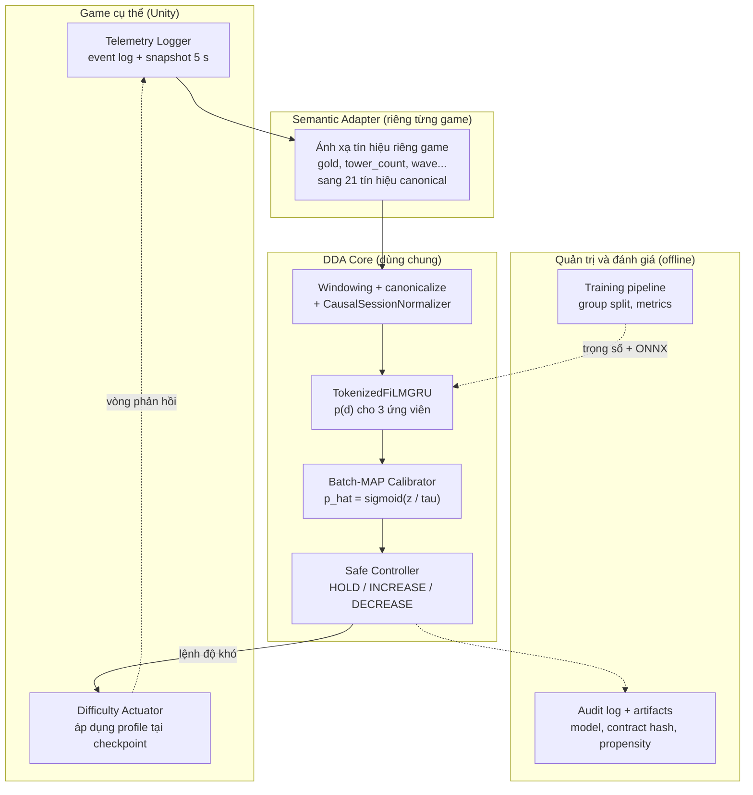

Đường liền là luồng thời gian thực; đường nét đứt là luồng ngoại tuyến hoặc quản trị. Cạnh `ACT -.-> LOG` là **vòng kín**: chính sách hiện tại định hình dữ liệu tương lai, nên bài toán không dừng (`report.md` §6.1).

---

## 2. BẢN ĐỒ MÃ NGUỒN

### 2.1. Cây thư mục (đã đối chiếu thực tế)

```text
D:\DDA-models\
├── configs\
│   ├── canonical_feature_contract.json   # 21 tín hiệu, cờ bounded, chính sách thiếu, công thức delta
│   └── difficulty_profiles.json          # 5 profile (0..4) của Tower Defense -> D_max = 4
├── docs\
│   ├── feasibility_and_scope_v2.md
│   └── implementation_v2.md
├── scripts\
│   ├── prepare_dataset.py                # session JSON -> window rows (bộ đặc trưng v1)
│   ├── train.py                          # baseline v1
│   └── train_adaptive.py                 # Tokenized FiLM GRU (v2)
├── src\ddamodels\
│   ├── adaptation.py                     # OnlineTemperatureCalibrator (batch-MAP, logit buffer)
│   ├── canonical.py                      # 21 canonical, log-ratio delta, CausalSessionNormalizer,
│   │                                     # build_difficulty_vector, masked_feature_dropout
│   ├── controller.py                     # ControllerState, Decision, decide()
│   ├── data.py                           # load_session, normalize_snapshot_frame,
│   │                                     # add_derived_features, build_window_rows,
│   │                                     # load_tokenized_window_dataset
│   ├── models.py                         # Majority, NumpyLogistic, CandidateConditionedGRU,
│   │                                     # TokenizedFiLMGRU, uncertainty, struggle, ONNX export
│   ├── segments.py                       # SegmentMode, SegmentContract, segment_boundary
│   └── train.py                          # group_split, aggregate_history, metrics, run_training
├── tests\                                # 14 test case trong 3 file (xem §10.5)
└── pyproject.toml, requirements.txt, README.md
```

### 2.2. Vai trò, đầu vào/ra và trạng thái từng mô-đun

| Mô-đun / hàm | Đầu vào | Đầu ra | Trạng thái |
|---|---|---|---|
| `data.load_session` | JSON/JSONL/Parquet/CSV | dict phiên đã kiểm tra trường bắt buộc | [Đã triển khai v2] |
| `data.normalize_snapshot_frame` | dict phiên | DataFrame snapshot, **không nội suy** | [Đã triển khai v2] |
| `data.add_derived_features` | DataFrame | thêm `progress_velocity`, `hp_loss_rate`, `error_slope`, `normalized_segment_index`... | [Đã triển khai v2] |
| `data.build_window_rows` | DataFrame snapshot | cửa sổ 12 snapshot, `history_json`, `context_json`, nhãn | [Đã triển khai v2], **chỉ đường v1** (G2, G3) |
| `data.load_tokenized_window_dataset` | bảng có `values_json`, `mask_json`, `difficulty_vector_json`, `difficulty_mask_json` | tensor $[N,12,21]$, $[N,10]$, nhãn, nhóm | [Đã triển khai v2] |
| `canonical.canonicalize` | mapping + cờ `available` | `CanonicalState(values, mask)` | [Đã triển khai v2] |
| `canonical.CausalSessionNormalizer` | mapping snapshot | giá trị chuẩn hóa + mask | [Đã triển khai v2] |
| `canonical.normalized_log_ratio_delta` | candidate, current, `max_step_ratio` | $\delta \in [-1,1]$ | [Đã triển khai v2] |
| `canonical.build_difficulty_vector` | 4 delta + prior + `prior_source` | values 5 chiều + mask 5 chiều | [Đã triển khai v2] |
| `canonical.compute_difficulty_adjusted_win_rate` | win rate, prior | (giá trị, mask) | [Đã triển khai v2] |
| `canonical.masked_feature_dropout` | values, mask, nhóm cần che | values/mask đã che | [Đã triển khai v2]; chưa dùng trong huấn luyện (§4.2) |
| `segments.segment_boundary` | mode, $t$, horizon, $t_{\text{finish}}$ | $[start, end]$ | [Đã triển khai v2] |
| `models.TokenizedFiLMGRU` | values, mask, context, difficulty | logit | [Đã triển khai v2] |
| `models.estimate_mask_uncertainty` | mask $[12,21]$ | $\mathcal{U}$ | [Đã triển khai v2] |
| `models.estimate_struggle_probability` | dict xác suất, độ khó hiện tại, win rate | $P_{\text{struggle}}$ | [Đã triển khai v2] |
| `models.export_tokenized_onnx` | model | `.onnx` static-shape, opset 17 | [Đã triển khai v2]; **chưa tương thích Sentis** (§8.1) |
| `adaptation.OnlineTemperatureCalibrator` | xác suất + nhãn | $\hat p = \sigma(z/\tau)$ | [Đã triển khai v2] |
| `controller.decide` | probabilities, uncertainties, current, state | `Decision(applied_difficulty, reason, scores, confidence)` | [Đã triển khai v2] |
| `train.group_split` | mảng nhóm | mặt nạ boolean + manifest | [Đã triển khai v2] |
| `train.metrics` | $y$, $p$ | Brier, Log Loss, Accuracy, ECE, ROC/PR-AUC, Balanced Acc. | [Đã triển khai v2]; PR-AUC sai lớp dương (§7.1) |

### 2.3. Đồ thị phụ thuộc mô-đun

Đường liền là quan hệ `import` thật trong mã. Đường nét đứt là luồng dữ liệu lúc chạy (các mô-đun không import nhau, bên gọi phải nối chúng lại).

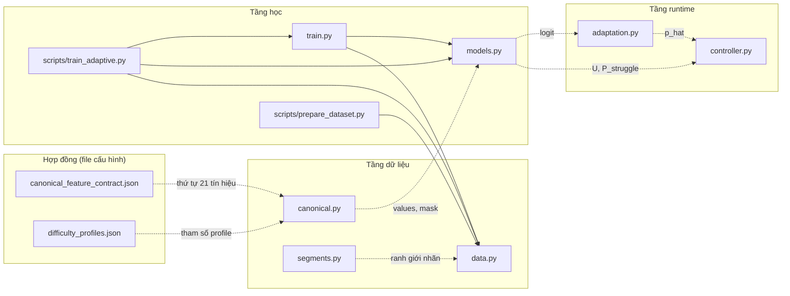

Ba nhận xét:

* `canonical.py`, `adaptation.py`, `controller.py`, `segments.py` **không import mô-đun nào khác** trong gói, chỉ dùng `numpy`. Đây là điều kiện tốt để dịch sang C#.
* `canonical_feature_contract.json` **chưa được mã đọc trực tiếp**: danh sách 21 tín hiệu và tập bounded được chép cứng trong `canonical.py`. Hai nơi có thể lệch nhau. **[Khuyến nghị]** thêm test so khớp JSON với hằng số trong mã.
* `segments.py` cũng chưa được `data.py` gọi; nhãn hiện phải được căn sẵn từ logger.

### 2.4. Khoảng trống triển khai cần biết trước khi báo cáo

Các điểm dưới đây quyết định tuyên bố nào được phép đưa vào báo cáo:

| # | Khoảng trống | Bằng chứng | Ảnh hưởng |
|---|---|---|---|
| G1 | `build_tokenized_window_rows()` **không tồn tại** | `data.py` chỉ có `build_window_rows()` (đặc trưng v1) và `load_tokenized_window_dataset()` | Đường ống v2 từ session tới values/mask canonical chưa khép kín trong repo |
| G2 | `build_window_rows` dùng `BASE_FEATURES` (23 biến v1) và `fillna(0)` | `data.py:258` | Đường v1 thay thiếu bằng số 0, trái nguyên tắc `(value, mask)`; chỉ dùng cho baseline |
| G3 | `history_json` không kèm mask | `data.py:258` | Không huấn luyện được `TokenizedFiLMGRU` từ đường v1 |
| G4 | `scripts/train_adaptive.py` không tính metric trên test | chỉ ghi `test_positive_rate` | Chưa có bằng chứng hiệu năng v2 khi chạy script này |
| G5 | `_fit_temperature` được định nghĩa nhưng không được gọi | `train.py:75-84` | Hiệu chuẩn offline chưa nối vào pipeline |
| G6 | `aggregate_history` chỉ có last/mean/std/slope | `train.py:29-34` | `report.md` §4.1 mô tả thêm min/max; cần đồng bộ |
| G7 | Không có early stopping | số epoch cố định | Yêu cầu dừng theo validation (`report.md` §4.5) chưa thỏa |
| G8 | `TokenizedFiLMGRU` không có Dropout | `models.py:130-165` | Chỉ `CandidateConditionedGRU` (v1) có dropout $0.2$ ở head |
| G9 | v1 dùng `pos_weight` mặc định | `models.py:89-93` | Lệch logit thêm $\ln(w_1/w_0)$; v2 không dùng, khớp `report.md` §4.6 |
| G10 | Chưa có test train–serve parity cho normalizer | không có test tương ứng | Bất biến quan trọng nhất của normalizer chưa được kiểm (§5.2) |

---

## 3. KIẾN TRÚC TỔNG THỂ

### 3.1. Sơ đồ phân tầng

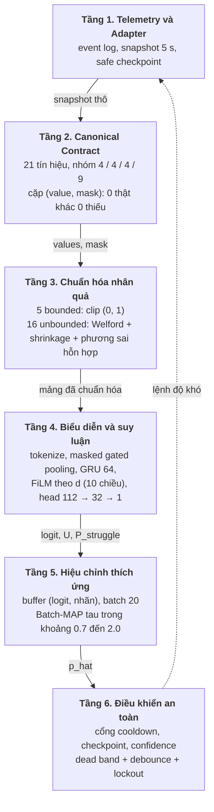

Chiều từ trên xuống là chiều trừu tượng tăng dần; cạnh nét đứt `L6 → L1` là vòng kín. Tầng 5 **có thể tắt** (zero-shot dùng $\tau=1$), và trạng thái bật/tắt phải ghi vào log quyết định (§8.4).

### 3.2. Đường ống dữ liệu và hình dạng tensor

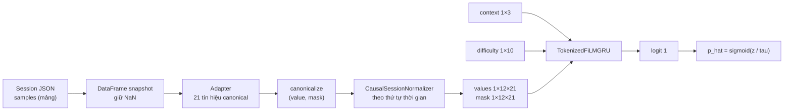

Hình dạng tensor bắt buộc để xuất ONNX static-shape **[Đã kiểm chứng trong mã]**:

| Tensor | Shape | Ghi chú |
|---|---|---|
| `values` | $[1, 12, 21]$ | FP32, đã chuẩn hóa |
| `mask` | $[1, 12, 21]$ | $m \in \{0,1\}$ |
| `context` | $[1, 3]$ | `progress_ratio`, `normalized_segment_index`, `current_difficulty` |
| `difficulty` | $[1, 10]$ | 5 giá trị + 5 mask |
| `logit` | $[1]$ | đầu ra duy nhất |

Bước `B → C` (adapter sang 21 tín hiệu canonical) **chưa có trong repo** (G1). Trong repo hiện chỉ có `build_window_rows` sinh đặc trưng v1.

### 3.3. Vòng kín thời gian thực

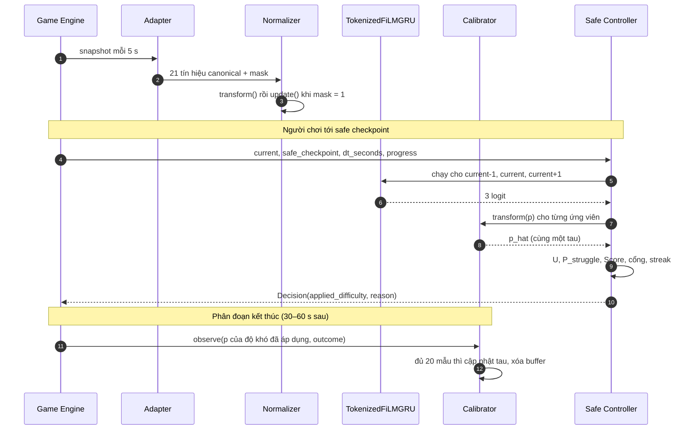

Hai điểm thời gian cần đọc kỹ:

* **Nhãn đến trễ** 30–60 s. Vì vậy calibrator cập nhật theo lô, và giá trị nạp vào buffer phải là dự báo **thô tại thời điểm quyết định**, không phải $\hat p$ đã hiệu chuẩn (nếu nạp $\hat p$, $\tau$ sẽ bị hiệu chỉnh chồng lên chính nó).
* **Một $\tau$ dùng chung cho cả ba ứng viên.** Đây là giả định "lệch đồng đều" (`report.md` §5.2, điểm 3), cần nêu trong phần giới hạn.

### 3.4. Pipeline huấn luyện ngoại tuyến

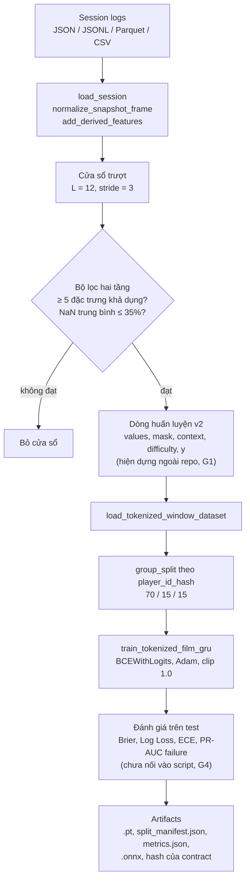

### 3.5. Ranh giới trách nhiệm ONNX và C#

| Thành phần | Trong ONNX | Trong C# | Lý do |
|---|:---:|:---:|---|
| Tokenize, pooling, GRU, FiLM, head | ✔ | — | Cần đồ thị tensor |
| `CausalSessionNormalizer` | — | ✔ | Có trạng thái tăng dần theo phiên |
| `EstimateGroupMaskUncertainty` | — | ✔ | Trung bình có trọng số |
| `EstimateStruggleProbability` | — | ✔ | Rẽ nhánh theo cờ khả dụng |
| `OnlineTemperatureCalibrator` | — | ✔ | 25 bước lặp trên buffer nhỏ |
| `SafeController` | — | ✔ | Logic tất định |

Normalizer, calibrator và controller giữ FP32 (dùng double cho $M_2$ của Welford khi phiên dài); chỉ mạng nơ-ron mới cân nhắc FP16 (`report.md` §8.2).

---

## 4. HỢP ĐỒNG DỮ LIỆU

### 4.1. 21 tín hiệu canonical

Nguồn: `configs/canonical_feature_contract.json` (version `canonical-v2`), trùng với `CANONICAL_FEATURES` trong `canonical.py`. **Thứ tự là một phần của hợp đồng**, vì `feature_embedding` gán vector 32 chiều theo chỉ số.

| # | Tín hiệu | Nhóm | Bounded | Chuẩn hóa |
|:---:|---|---|:---:|---|
| 0 | `progress_ratio` | `progress_tempo` | ✔ | clip $[0,1]$ |
| 1 | `progress_velocity` | `progress_tempo` | — | shrinkage |
| 2 | `time_budget_ratio` | `progress_tempo` | — | shrinkage (có thể $>1$ khi bù giờ) |
| 3 | `tempo_rate` | `progress_tempo` | — | shrinkage |
| 4 | `vitality_ratio` | `vitality_error` | ✔ | clip $[0,1]$ |
| 5 | `vitality_loss_rate` | `vitality_error` | — | shrinkage |
| 6 | `critical_error_rate` | `vitality_error` | — | shrinkage |
| 7 | `failure_cost_ratio` | `vitality_error` | — | shrinkage |
| 8 | `resource_reserve_ratio` | `capability_economy` | — | shrinkage |
| 9 | `resource_utilization_rate` | `capability_economy` | — | shrinkage |
| 10 | `capability_ratio` | `capability_economy` | — | shrinkage |
| 11 | `threat_pressure_ratio` | `capability_economy` | — | shrinkage |
| 12 | `action_frequency` | `human_cognitive_motor` | — | shrinkage |
| 13 | `invalid_action_rate` | `human_cognitive_motor` | ✔ | clip $[0,1]$ |
| 14 | `idle_ratio` | `human_cognitive_motor` | ✔ | clip $[0,1]$ |
| 15 | `reaction_latency` | `human_cognitive_motor` | — | shrinkage |
| 16 | `error_slope` | `human_cognitive_motor` | — | shrinkage |
| 17 | `recent_segment_win_rate` | `human_cognitive_motor` | ✔ | clip $[0,1]$; mask $=0$ đầu trận |
| 18 | `recent_average_difficulty` | `human_cognitive_motor` | — | shrinkage; mask $=0$ đầu trận |
| 19 | `difficulty_adjusted_win_rate` | `human_cognitive_motor` | — | shrinkage; miền $[-1,1]$ |
| 20 | `efficiency_ratio` | `human_cognitive_motor` | — | shrinkage |

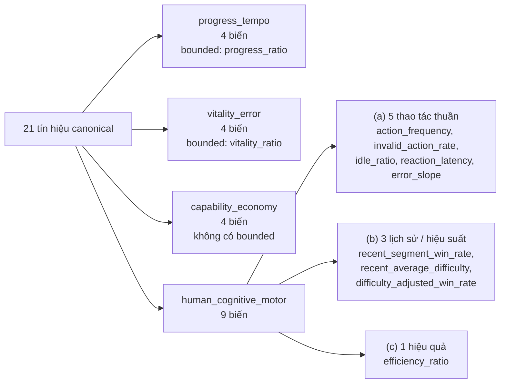

Ba điểm phải nêu đúng trong báo cáo (`report.md` §2.1):

1. **Nhóm cuối không thuần nhất.** Lập luận "tín hiệu con người có quy luật tương đồng giữa các game" chỉ áp dụng cho 5 biến thao tác thuần (12–16), và vẫn là giả thuyết cần kiểm chứng ở bậc 3. Ba biến lịch sử (17–19) phụ thuộc thang độ khó của từng game và có mask $=0$ ở đầu trận.
2. **Trọng số nhóm bằng nhau nhưng số biến khác nhau.** Coverage dùng $0.25$ mỗi nhóm, nên mỗi biến của nhóm 9 biến chỉ nặng $0.25/9 \approx 2.8\%$, so với $6.25\%$ ở nhóm 4 biến. Hệ thống chịu mất 5/9 biến motor nhưng chỉ chịu mất 2/4 biến ở nhóm khác (§5.4).
3. **`difficulty_adjusted_win_rate`** $= \bar y_{\text{recent}} - \overline{\pi_0(d_{\text{recent}})} \in [-1,1]$. **[Đã kiểm chứng trong mã]** `compute_difficulty_adjusted_win_rate` trả `(0.0, 0.0)` khi không có prior, nên không bịa prior.

### 4.2. Hợp đồng dữ liệu thiếu

**Biểu diễn `(value, mask)`** trong `canonicalize`:

$$\text{giá trị hữu hạn} \Rightarrow (x, 1);\qquad \text{vắng mặt, NaN hoặc available=False} \Rightarrow (0, 0).$$

Cặp $(0,1)$ là quan sát thật bằng 0 (ví dụ HP $=0$); cặp $(0,0)$ là thiếu. Trong mô hình, mask vừa là đầu vào của `value_net` (vector `[value, mask]`) vừa là hệ số nhân của trọng số pooling, nên token thiếu không đóng góp vào $\zeta_t$.

**Bộ lọc hai tầng của `build_window_rows`** **[Đã kiểm chứng trong mã, `data.py:245-249`]**:

| Tầng | Quy tắc | Mục đích |
|---|---|---|
| 1. Thiếu theo chiều đặc trưng | Cửa sổ cần ≥ 5 đặc trưng có ít nhất một quan sát | Game thiếu hẳn một nhóm vẫn tạo được cửa sổ; mask $=0$ xử lý phần còn lại |
| 2. Thiếu theo trục thời gian | Loại cửa sổ nếu tỷ lệ NaN trung bình $> 35\%$, chỉ tính trên đặc trưng khả dụng | Chặn cửa sổ đứt gãy do mất kết nối hoặc mất snapshot |

Ngưỡng $5$ và $35\%$ là **siêu tham số cần phân tích độ nhạy** (`report.md` §2.3).

**Nguyên tắc không nội suy.** Nội suy tuyến tính (i) tạo trạng thái chưa từng xảy ra, và (ii) dùng mốc *sau* thời điểm đang xét, tức rò rỉ tương lai. **[Đã kiểm chứng trong mã]** `normalize_snapshot_frame` giữ `NaN` và không gọi `.interpolate()`.

**Feature-group dropout trong huấn luyện.** Khi mất cả một nhóm, $\zeta_t$ là trung bình của các token còn lại. Nếu huấn luyện luôn đủ nhóm, GRU chưa từng thấy phân phối này. Vì vậy cần che ngẫu nhiên từng nhóm trong huấn luyện (luôn giữ ít nhất 2 nhóm). **[Đã kiểm chứng trong mã]** `masked_feature_dropout` có trong `canonical.py` nhưng `train_tokenized_film_gru` **không gọi nó**; hiện hàm này chỉ dùng được cho Benchmark B.

### 4.3. Vector độ khó 10 chiều

| Chỉ số | Tên | Miền | Ghi chú |
|:---:|---|---|---|
| 0 | `relative_step` | $[-1,1]$ | Với ứng viên $\{c-1,c,c+1\}$ nhận $\{-1,0,+1\}$ |
| 1 | `pressure_delta` | $[-1,1]$ | log-ratio áp lực kẻ địch |
| 2 | `forgiveness_delta` | $[-1,1]$ | log-ratio mức tha thứ sai sót |
| 3 | `resource_delta` | $[-1,1]$ | log-ratio tiếp tế/hồi phục |
| 4 | `empirical_prior` | $[0,1]$ | Xác suất thắng tiên nghiệm của profile ứng viên |
| 5–8 | mask của 0–3 | $\{1\}$ | Luôn bằng 1 |
| 9 | mask của `empirical_prior` | $\{0,1\}$ | Bằng 1 chỉ khi `prior_source == "fixed_randomized_same_domain"` |

**Công thức delta** (`normalized_log_ratio_delta`):

$$\delta_j = \operatorname{clip}\!\left(\frac{s_j \ln(a_j^{\text{cand}}/a_j^{\text{cur}})}{\ln r_{\max}},\,-1,\,1\right),\qquad s_j\in\{+1,-1\}.$$

Tính chất (chứng minh ở `report.md` §2.5): phản đối xứng, bất biến theo đơn vị đo, cộng tính trước khi clip, chặn trong $[-1,1]$.

**[Đã kiểm chứng trong mã]**

* Hàm ném `ValueError` nếu `candidate <= 0`, `current <= 0` hoặc `max_step_ratio <= 1`, khớp điều kiện "tham số phải dương" của `report.md` §2.5.
* **Quy ước dấu $s_j$ chưa có trong mã.** Hàm chỉ nhận hai giá trị. Người gọi phải tự đảo dấu cho tham số "càng lớn càng dễ" (ví dụ `resource_rate_ratio`), nếu không tính đơn điệu theo từng tọa độ không phát biểu được.
* **Chưa có hàm ánh xạ** từ `difficulty_profiles.json` (`enemy_count_ratio`, `enemy_speed_ratio`, `enemy_hp_ratio`, `resource_rate_ratio`, `checkpoint_factor`) sang 4 delta; $r_{\max}$ cũng chưa được cấu hình. **[Cần xác minh]**
* `build_difficulty_vector` khi prior không hợp lệ thì **ép cả giá trị về 0** chứ không chỉ đặt mask, đúng chính sách `empirical_prior_policy` trong contract JSON.

**Rủi ro target encoding của `empirical_prior`.** $\pi_0(d)\approx\Pr(Y=1\mid\text{profile } d)$ là thống kê của chính nhãn. Ba yêu cầu (`report.md` §2.5): chỉ tính từ người chơi tập train (hoặc out-of-fold); làm mượt Beta–Binomial khi ít mẫu; trong huấn luyện phải có hàng `mask[9]=0` để mô hình học được đường zero-shot.

### 4.4. Hợp đồng phân đoạn

| Mode | Ranh giới | Khoảng nhãn | Ràng buộc **[Đã kiểm chứng trong mã]** |
|---|---|---|---|
| `EVENT_BOUNDED` | Theo cấu trúc game (wave, room, checkpoint) | $[t, t_{\text{finish}}]$ | `horizon_seconds` trong $[30, 60]$ |
| `FIXED_HORIZON` | Cửa sổ thời gian cố định | $[t, t+h]$ | $h > 0$ |

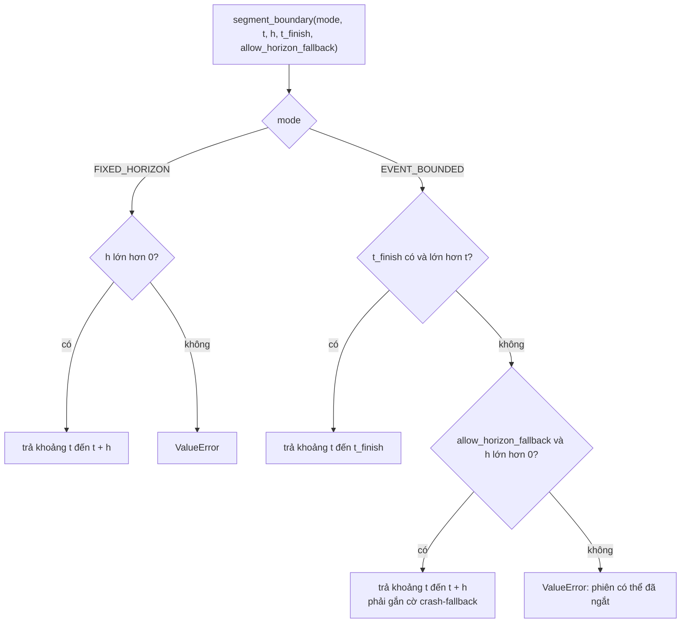

Các cửa sổ đi qua nhánh crash-fallback có ngữ nghĩa nhãn khác (horizon thay cho sự kiện), nên **phải gắn cờ và loại khỏi tập test** (`report.md` §1.4). Hàm hiện chỉ trả tuple, không trả cờ; người gọi phải tự ghi lại. **[Khuyến nghị]**

### 4.5. Định nghĩa nhãn và ba trường hợp biên

`segment_success = 1` nếu hoàn thành phân đoạn theo tiêu chí game, $=0$ nếu thất bại. `SegmentContract.label_definition()` hiện gộp `failure/quit/timeout` vào nhãn 0 cho `EVENT_BOUNDED`. `report.md` §1.4 yêu cầu tách rõ hơn:

| Trường hợp | Vấn đề | Xử lý đề xuất |
|---|---|---|
| Quit giữa phân đoạn | Kiểm duyệt có thông tin: người chơi hay thoát sau đoạn quá khó; bỏ mẫu gây thiên lệch sống sót | Ghi 3 lớp `won/lost/quit`; huấn luyện trên `won/lost`; phân tích độ nhạy với hai quy tắc (quit là thua, hoặc loại bỏ). Calibrator dùng cùng quy tắc với lúc huấn luyện |
| Crash-fallback | Nhãn theo horizon khác ngữ nghĩa nhãn theo sự kiện | Gắn cờ, loại khỏi test |
| Phân đoạn dài bất thường | Có thể là lỗi logger | Ghi thời lượng, phân tích phụ |

---
---

## 5. CHI TIẾT CÁC PHÂN HỆ

### 5.1. Phân hệ Chuẩn hóa: `CausalSessionNormalizer`

Phân hệ đảm nhiệm việc co cụm phân phối tín hiệu về mức chuẩn mà không gây rò rỉ thông tin tương lai.
Mã nguồn: `src/ddamodels/canonical.py:85-134` **[Đã kiểm chứng trong mã]**.

#### a. Quy trình xử lý hai nhánh

Tín hiệu tại mỗi snapshot được phân loại thành hai nhóm với cơ chế xử lý hoàn toàn tách biệt:

* **Nhóm Bounded (5 biến):** `progress_ratio`, `vitality_ratio`, `invalid_action_rate`, `idle_ratio`, `recent_segment_win_rate`.
  $$\tilde x = \operatorname{clip}(x, 0.0, 1.0)$$
  Giữ nguyên giá trị tuyệt đối nhằm bảo toàn trọn vẹn ngữ nghĩa vật lý và tín hiệu báo động nguy cấp (ví dụ: máu 10% luôn là nguy kịch, không bị biến dạng do Z-score).
* **Nhóm Unbounded (16 biến còn lại):** Áp dụng thuật toán co cụm Bayes (Bayesian Shrinkage) kết hợp cập nhật trực tuyến Welford khi `mask == 1.0`.

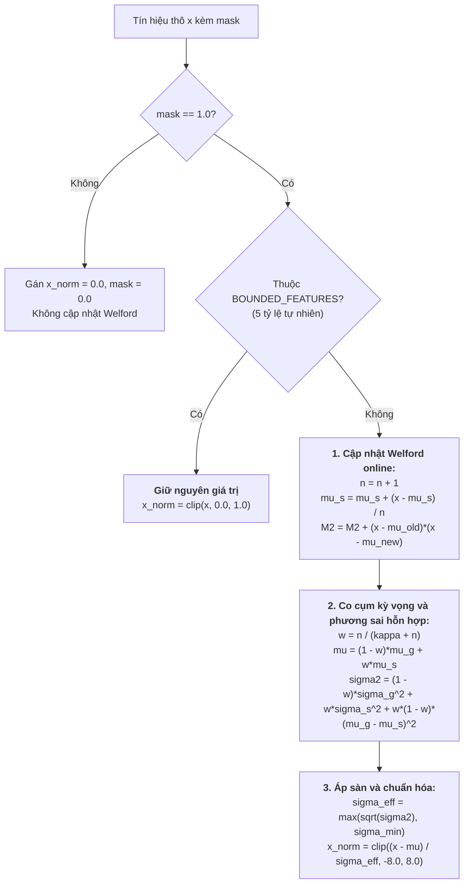

#### b. Công thức toán học và thông số thiết kế

1. **Cập nhật Welford trực tuyến (Chỉ khi `mask == 1`):**
   $$n \leftarrow n + 1, \qquad \delta = x - \mu_{\text{old}}, \qquad \mu_s \leftarrow \mu_{\text{old}} + \frac{\delta}{n}, \qquad M_2 \leftarrow M_2 + \delta (x - \mu_s), \qquad s^2 = \frac{M_2}{\max(n - 1, 1)}$$
2. **Trọng số co cụm (Shrinkage We\right):**
   $$w = \frac{n}{\kappa + n}, \qquad \text{với } \kappa = 10.0 \text{ (tham số prior\_weight)} \quad \textbf{[Đã kiểm chứng trong mã]}$$
   Ở đầu phiên ($n \to 0$), $w \to 0$, mô hình bám vào phân phối nền toàn game $(\mu_g, \sigma_g)$. Khi phiên chơi kéo dài ($n \to \infty$), $w \to 1$, phân phối hội tụ về đặc tính riêng của phiên chơi đó.
3. **Phương sai hỗn hợp đầy đủ (Mixture Variance):**
   $$\sigma^2 = (1 - w)\sigma_g^2 + w\sigma_s^2 + w(1 - w)(\mu_g - \mu_s)^2$$
   Số hạng $w(1 - w)(\mu_g - \mu_s)^2$ phản ánh phương sai giữa hai nhóm (between-group variance), giúp $\sigma_{\text{eff}}$ mở rộng chính xác khi trình độ của người chơi lệch xa mức trung bình của game (`report.md` §2.6).
4. **Sàn độ lệch chuẩn và kẹp biên:**
   $$\sigma_{\text{eff}} = \max\!\big(\sqrt{\sigma^2},\, \sigma_{\min}\big), \quad \sigma_{\min} = 0.05; \qquad \tilde x = \operatorname{clip}\!\left(\frac{x - \mu}{\sigma_{\text{eff}}},\, -8.0,\, 8.0\right) \quad \textbf{[Đã kiểm chứng trong mã]}$$

#### c. Rủi ro Train–Serve Parity (G10)
Bộ chuẩn hóa có trạng thái phụ thuộc thứ tự thời gian. Nếu trong huấn luyện dữ liệu được chuẩn hóa theo batch ngẫu nhiên hoặc nội suy ngoài thứ tự, mô hình sẽ gặp hiện tượng lệch phân phối khi triển khai online. Cần bổ sung unit test kiểm chứng tính nhất quán giữa chế độ streaming từng snapshot và chế độ batch tĩnh **[Khuyến nghị]**.

---

### 5.2. Phân hệ Mô hình Học sâu: `TokenizedFiLMGRU`

Mô hình học sâu chịu trách nhiệm ước lượng xác suất thành công cho từng can thiệp độ khó.
Mã nguồn: `src/ddamodels/models.py:130-168` **[Đã kiểm chứng trong mã]**.

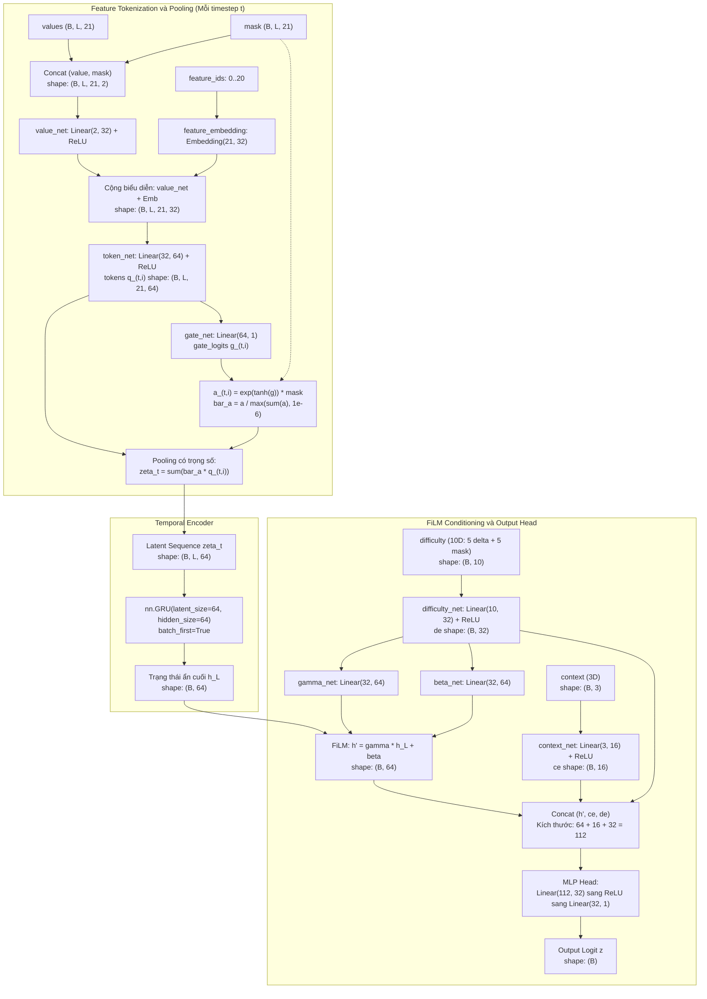

#### a. Đặc tả chi tiết các tầng mạng

1. **Per-Feature Tokenizer:**
   * Bảng nhúng danh tính $E \in \mathbb{R}^{21 \times 32}$ ánh xạ cố định 21 loại tín hiệu thành vector ngữ nghĩa.
   * `value_net` nhận vector 2 chiều `[value, mask]`, chiếu lên không gian 32 chiều.
   * Vector token: $q_{t,i} = \text{ReLU}\big(W_q (\text{ReLU}(W_v [x_{t,i}, m_{t,i}] + b_v) + E[i]) + b_q\big) \in \mathbb{R}^{64}$.
2. **Static-Shape Masked Gated Weighted Pooling:**
   * Trọng số thô: $a_{t,i} = \exp(\tanh(w_g^\top q_{t,i} + b_g)) \cdot m_{t,i}$.
   * Vì $\tanh \in [-1, 1]$, nên với các token khả dụng ($m=1$), $a_{t,i} \in [e^{-1}, e] \approx [0.368, 2.718]$. Tỷ số tương phản tối đa giữa 2 đặc trưng bất kỳ bị chặn trên bởi $e^2 \approx 7.39$. Đây là cơ chế attention mềm có độ tương phản bị chặn (`report.md` §4.3).
   * Chuẩn hóa tĩnh: $\bar a_{t,i} = \frac{a_{t,i}}{\max(\sum_j a_{t,j}, 10^{-6})}$. Khi có ít nhất 1 đặc trưng khả dụng, mẫu số $\ge 0.368$ nên $10^{-6}$ không bị kích hoạt; nó đóng vai trò triệt tiêu `NaN` khi $M_t = 0$.
   * Vector trạng thái gộp: $\zeta_t = \sum_{i=1}^{21} \bar a_{t,i} q_{t,i} \in \mathbb{R}^{64}$, bảo đảm kích thước cố định cho GRU.
3. **Temporal Backbone (GRU):**
   * `nn.GRU(input_size=64, hidden_size=64, batch_first=True)` trích xuất trạng thái ẩn cuối cùng $h_L \in \mathbb{R}^{64}$.
4. **FiLM Conditioning (Feature-wise Linear Modulation):**
   * Nhận vector độ khó 10 chiều (5 delta + 5 mask) $\to d_e \in \mathbb{R}^{32}$.
   * Sinh hệ số co giãn $\gamma \in \mathbb{R}^{64}$ và độ dịch $\beta \in \mathbb{R}^{64}$:
     $$\mathbf{h}' = \boldsymbol{\gamma}(\mathbf{d}_e) \odot \mathbf{h}_L + \boldsymbol{\beta}(\mathbf{d}_e)$$
   * Tác động trực tiếp vào biểu diễn thời gian ẩn thay vì chỉ ghép nối ở lớp cuối cùng.
5. **Output Head:**
   * Ghép vector $h' \in \mathbb{R}^{64}$, ngữ cảnh $c_e \in \mathbb{R}^{16}$ và vector độ khó $d_e \in \mathbb{R}^{32}$ thành vector 112 chiều.
   * Qua mạng MLP 2 tầng (Linear 112 $\to$ 32, ReLU, Linear 32 $\to$ 1) xuất ra logit vô hướng $z$.

#### b. Rủi ro kiến trúc S-Learner
Mô hình thuộc họ S-Learner (Single-model learner nhận can thiệp $d$ làm một nhánh đầu vào). Rủi ro cố hữu là nếu không kiểm soát tốt gradient, mạng có thể học đường tắt (shortcut) dựa hoàn toàn vào lịch sử người chơi $h_L$ và triệt tiêu ảnh hưởng của $d_e$. Bắt buộc phải có bài kiểm tra độ nhạy can thiệp ở Benchmark C (§7.5).

---

### 5.3. Phân hệ Hiệu chuẩn Online: `OnlineTemperatureCalibrator`

Phân hệ đảm bảo xác suất dự báo phản ánh trung thực tần suất thành công thực tế mà không làm đảo lộn thứ tự ưu tiên của các ứng viên độ khó.
Mã nguồn: `src/ddamodels/adaptation.py:6-60` **[Đã kiểm chứng trong mã]**.

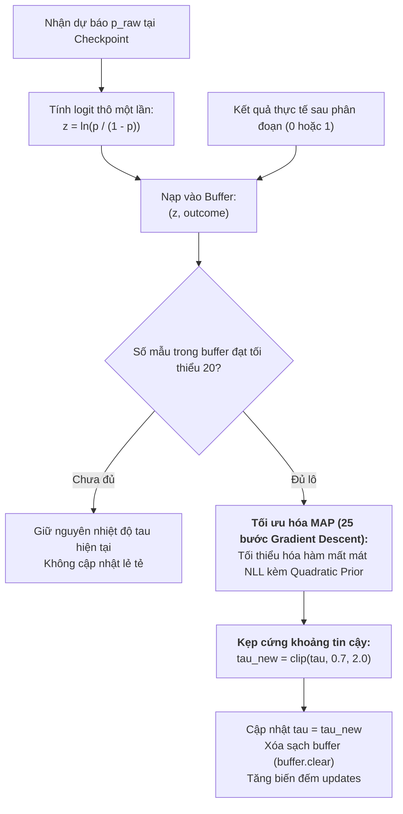

#### a. Cơ chế Temperature Scaling
Xác suất hiệu chuẩn:
$$\hat p = \sigma\left(\frac{z}{\tau}\right) = \frac{1}{1 + \exp(-z / \tau)}, \qquad \tau \in [0.7, 2.0] \quad \textbf{[Đã kiểm chứng trong mã]}$$
* $\tau > 1.0$: Mô hình quá tự tin $\to$ làm dịu xác suất về mức $0.5$.
* $\tau < 1.0$: Mô hình thiếu tự tin $\to$ đẩy xác suất sắc nét hơn về 0 hoặc 1.
* Vì hàm $u \mapsto \sigma(u / \tau)$ đơn điệu tăng ngặt, phép biến đổi này **bảo toàn 100% thứ tự logit**: ROC-AUC, PR-AUC và quyết định tại ngưỡng $0.5$ không hề bị xáo trộn.

#### b. Thuật toán tối ưu hóa MAP trên Logit Buffer
Buffer lưu trực tiếp cặp logit và nhãn $(z_i, y_i)$ thay vì xác suất $(p_i, y_i)$. Điều này loại bỏ hoàn toàn việc tính toán lặp lại hàm nghịch đảo sigmoid trong vòng lặp tối ưu và triệt tiêu nguy cơ tràn số khi $p \to 0$ hoặc $p \to 1$.

Hàm mục tiêu MAP:
$$\mathcal{L}_{\text{MAP}}(\tau) = \sum_{i=1}^B \left[ \ln\big(1 + e^{-z_i/\tau}\big) + (1 - y_i)\frac{z_i}{\tau}\right] + \frac{\lambda_{\text{prior}}}{2} (\tau - \tau_{\text{base}})^2$$
Đạo hàm gradient:
$$\frac{\partial \mathcal{L}_{\text{MAP}}}{\partial \tau} = \sum_{i=1}^B \big(\sigma(z_i / \tau) - y_i\big) \left(-\frac{z_i}{\tau^2}\right) + \lambda_{\text{prior}} (\tau - \tau_{\text{base}})$$
Với $\tau_{\text{base}} = 1.0$, $\lambda_{\text{prior}} = 10.0$, learning rate $= 0.02$, tối ưu qua 25 vòng lặp **[Đã kiểm chứng trong mã]**.
Sau khi cập nhật, $\tau$ được kẹp cứng trong $[0.7, 2.0]$ và bộ nhớ đệm được giải phóng hoàn toàn (`buffer.clear()`).

---

### 5.4. Phân hệ Bất định theo Độ phủ và Chỉ số Khó khăn

Mã nguồn: `src/ddamodels/models.py:213-255` **[Đã kiểm chứng trong mã]**.

#### a. Độ tin cậy theo độ phủ đầu vào (`estimate_mask_uncertainty`)

Hệ thống ước lượng độ bất định dựa trên tỷ lệ diện tích mặt nạ có trọng số nhóm (Group-Weighted Coverage):

$$\text{coverage} = 0.25 \cdot c_{\text{progress}} + 0.25 \cdot c_{\text{vitality}} + 0.25 \cdot c_{\text{capability}} + 0.25 \cdot c_{\text{motor}}$$
$$\mathcal{U} = u_{\text{base}} + (1 - \text{coverage})(1 - u_{\text{base}}), \qquad u_{\text{base}} = 0.05$$
$$\text{Confidence} = 1 - \mathcal{U} = (1 - u_{\text{base}}) \cdot \text{coverage} = 0.95 \cdot \text{coverage}$$

* **Chống bẫy đầu trận:** Khi bắt đầu ván chơi, 3 biến lịch sử (`recent_segment_win_rate`, `recent_average_difficulty`, `difficulty_adjusted_win_rate`) có mask $=0$. Do nhóm motor có 9 biến, độ phủ nhóm motor vẫn đạt $6/9 \approx 66.7\%$.
  $$\text{coverage} = 0.25 \times (1 + 1 + 1 + 6/9) = 0.9167 \implies \text{Confidence} = 0.95 \times 0.9167 = 0.8708 \ge 0.80$$
  Hệ thống hoàn toàn vượt qua cổng an toàn Gate 3, không bị đóng băng oan uổng.
* **Kích hoạt chính xác khi mất nhóm cốt lõi (Benchmark B):** Nếu mất toàn bộ 4 biến nhóm `vitality_error`:
  $$\text{coverage} = 0.25 \times (1 + 0 + 1 + 1) = 0.75 \implies \text{Confidence} = 0.95 \times 0.75 = 0.7125 < 0.80$$
  Controller lập tức kích hoạt cổng khóa `HOLD_LOW_CONFIDENCE`.

> [!IMPORTANT]
> Đây là **Input-Coverage Confidence** (độ tin cậy theo độ đầy đủ của dữ liệu cảm biến đầu vào), hoàn toàn không phải Epistemic Uncertainty thật sự của trọng số mô hình. Để đo lường epistemic uncertainty toán học, cần sử dụng Deep Ensemble (3–5 seeds) hoặc Monte Carlo Dropout (`report.md` §5.3).

#### b. Chỉ số Khó khăn Heuristic (`estimate_struggle_probability`)

Được thiết kế nhằm phát hiện sớm trạng thái người chơi rơi vào khủng hoảng:

$$P_{\text{struggle}} = \begin{cases} 1.0 - p(d_{\text{cur}}), & \text{khi } \text{win rate chưa khả dụng (mask[17] = 0)}, \\[6pt] 0.6 \cdot \big(1.0 - p(d_{\text{cur}})\big) + 0.4 \cdot \big(1.0 - \text{recent\_win\_rate}\big), & \text{khi } \text{win rate khả dụng}. \end{cases}$$

1. **Sử dụng trực tiếp $p(d_{\text{cur}})$:** Không lấy trung bình các ứng viên độ khó. Điều này ngăn chặn việc ứng viên dễ ($d_{\text{cur}}-1$) có xác suất cao làm loãng tín hiệu nguy cấp của mức độ khó hiện tại.
2. **Cờ kiểm tra khả dụng:** Ngăn chặn giá trị giữ chỗ `0.0` của `recent_win_rate` ở đầu trận cộng nhầm $0.40$ điểm vào chỉ số khó khăn, loại bỏ hoàn toàn hiện tượng tự động hạ độ khó oan ở wave 1.

---

### 5.5. Phân hệ Điều khiển An toàn: `SafeController` và Quyết định

Mã nguồn: `src/ddamodels/controller.py:9-58` **[Đã kiểm chứng trong mã]**.

#### a. Hàm điểm ứng viên (Candidate Scoring)

Với mỗi ứng viên $d \in \{d_{\text{cur}}-1, d_{\text{cur}}, d_{\text{cur}}+1\} \cap \{0, \dots, D_{\max}\}$:

$$\text{Score}(d) = -\big|\hat p(d) - P_{\text{target}}\big| - \lambda_u \mathcal{U}(d) - \lambda_c |d - d_{\text{cur}}|$$
Với $P_{\text{target}} = 0.70$, $\lambda_u = 0.25$, $\lambda_c = 0.05$ **[Đã kiểm chứng trong mã]**.

* Số hạng $\lambda_c |d - d_{\text{cur}}|$ đặt ra một rào cản chi phí thay đổi: việc tăng/giảm độ khó chỉ được chọn nếu khoảng cách tới mục tiêu dòng chảy $0.70$ cải thiện vượt trội hơn mức phạt $0.05$.
* Hiện tại $\mathcal{U}(d)$ phụ thuộc vào mask của cửa sổ nên bằng nhau giữa các ứng viên; nó đóng vai trò hạ thấp điểm tổng thể khi dữ liệu kém.

#### b. Máy trạng thái quyết định và Cổng bảo vệ

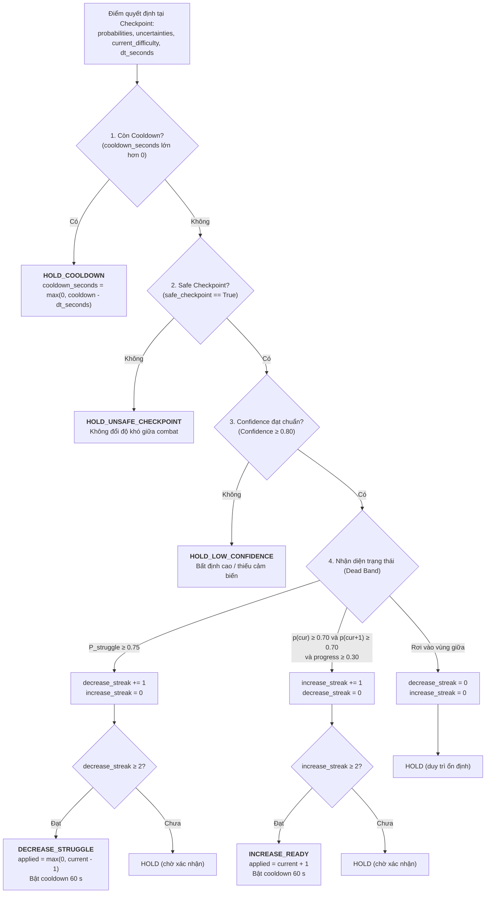

#### c. Phân tích cơ chế: Vùng chết, Xác nhận liên tiếp và Khóa thời gian

Để tránh dùng sai thuật ngữ học thuật (`report.md` §6.4):
1. **Vùng chết (Dead Band):** Khoảng xác suất nằm giữa ngưỡng giảm ($P_{\text{struggle}} \ge 0.75$) và ngưỡng tăng ($\hat p \ge 0.70$). Khi người chơi dao động nhẹ quanh mức tối ưu, hệ thống không can thiệp.
2. **Xác nhận liên tiếp (Debouncing / Persistence Filter):** Yêu cầu streak $\ge 2$ chu kỳ liên tiếp thỏa mãn điều kiện mới thực thi hành động. Điều này triệt tiêu hoàn toàn hiện tượng rung lắc (thrashing / oscillation) do nhiễu tức thời.
3. **Khóa thời gian thực (Lockout / Refractory Period):** Trừ thời gian thực `dt_seconds` trôi qua. Sau khi đổi độ khó, hệ thống khóa cứng 60 giây để người chơi làm quen với thử thách mới.

---

### 5.6. Bảy bất biến an toàn (Invariants I1–I7) của tầng điều khiển

Tầng điều khiển phải tuân thủ nghiêm ngặt 7 bất biến an toàn toán học sau:

| Mã | Bất biến an toàn | Ý nghĩa cơ học | Vị trí kiểm chứng trong mã |
|:---:|---|---|---|
| **I1** | $|d_{k+1} - d_k| \le 1$ | Độ khó chỉ được thay đổi tối đa 1 bậc mỗi quyết định, không nhảy cóc đột ngột. | `controller.py:31` (`abs(int(k) - current) <= 1`) |
| **I2** | $d_k \in \{0, \dots, D_{\max}\}$ | Độ khó luôn nằm trong giới hạn profile được game hỗ trợ ($D_{\max} = 4$). | `controller.py:53` (`max(0, current - 1)`) |
| **I3** | $\text{Cooldown} > 0 \implies d_{k+1} = d_k$ | Khóa thời gian tuyệt đối: không thay đổi độ khó khi thời gian hồi chưa hết. | `controller.py:37-39` (`HOLD_COOLDOWN`) |
| **I4** | $\text{SafeCheckpoint} = \text{False} \implies d_{k+1} = d_k$ | Chốt an toàn ngữ cảnh: không đổi độ khó khi người chơi đang giao tranh ác liệt. | `controller.py:40-41` (`HOLD_UNSAFE_CHECKPOINT`) |
| **I5** | $\text{Confidence} < 0.80 \implies d_{k+1} = d_k$ | Chốt bất định: thiếu cảm biến hoặc dữ liệu không tin cậy thì đóng băng hệ thống. | `controller.py:42-43` (`HOLD_LOW_CONFIDENCE`) |
| **I6** | $\text{Streak} < 2 \implies d_{k+1} = d_k$ | Chống rung lắc: chỉ kích hoạt thay đổi khi xu hướng kéo dài ít nhất 2 chu kỳ. | `controller.py:50, 54` (`streak >= 2`) |
| **I7** | Fail-safe Default | Bất kỳ biệt lệ phần mềm, lỗi mạng hoặc `NaN` đều fallback về `HOLD`. | `controller.py:33` (`NO_VALID_CANDIDATE`) |

---

## 6. TOÀN VẸN DỮ LIỆU VÀ TÍNH ĐÚNG ĐẮN NHÂN QUẢ

### 6.1. Rò rỉ dữ liệu (Data Leakage) và cô lập ranh giới nhân quả

Rò rỉ dữ liệu là nguyên nhân số một khiến các mô hình DDA có điểm số offline hoàn hảo nhưng thất bại khi chạy thực tế. Hệ thống thiết lập rào cản nhân quả nghiêm ngặt:

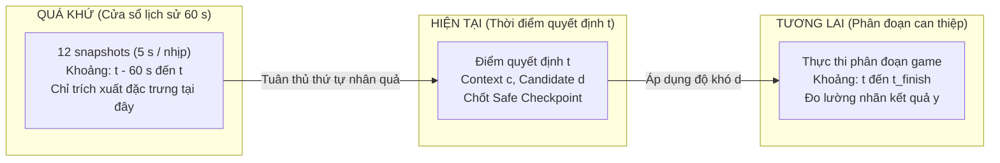

1. **Ranh giới thời gian tuyệt đối:** Cửa sổ quan sát kết thúc chính xác tại thời điểm ra quyết định $t$. Mọi sự kiện phát sinh sau $t$ tuyệt đối không được tham gia tính toán đặc trưng.
2. **Danh mục đặc trưng bị cấm (Banned Features):**
   * Số lần chết trong phân đoạn kế tiếp (`deaths_in_horizon`).
   * Sát thương phải nhận trong tương lai (`damage_taken_horizon`).
   * Kết quả toàn cục của cả trận đấu (`match_result = Won/Lost`). Việc sao chép nhãn thắng chung cuộc cho mọi snapshot là sai lầm nghiêm trọng vi phạm tính nhân quả.
3. **Chuẩn hóa thuần Causal:** `CausalSessionNormalizer` chỉ tích lũy dữ liệu từ đầu phiên đến thời điểm hiện tại $t$, không sử dụng thống kê của toàn bộ ván chơi để chuẩn hóa các mốc ban đầu.

---

### 6.2. Chia tập theo nhóm (Group Split) và cấu trúc phân cụm

* **Khóa phân nhóm bắt buộc:** `player_id_hash` (fallback về `session_id` nếu thiếu).
* **Quy tắc phân chia:** $70\%$ Train, $15\%$ Validation, $15\%$ Test **[Đã kiểm chứng trong mã, `train.py:13-26`]**.
* **Bảo vệ chống tự tương quan (Autocorrelation):** Các snapshot trong cùng một phiên hoặc từ cùng một người chơi có tương quan chuỗi rất mạnh. Nếu xáo trộn ngẫu nhiên từng dòng (Random Split), mô hình sẽ ghi nhớ phong cách người chơi thay vì học quy luật trò chơi, làm tăng ảo $15\text{--}25\%$ AUC.
* **Đánh giá thống kê:** Mọi khoảng tin cậy của chỉ số kiểm thử phải được tính bằng phương pháp Cluster Bootstrap theo người chơi (`report.md` §3.2).

---

### 6.3. Tính đúng đắn nhân quả: Ba giả thiết A1, A2, A3

Để hàm ước lượng $\sigma(f_\theta(h, c, d))$ phản ánh chính xác kết quả can thiệp $\Pr(Y=1 \mid \text{do}(d))$, dữ liệu huấn luyện phải thỏa mãn 3 giả thiết nền tảng của suy diễn nhân quả (Neyman–Rubin Causal Framework):

1. **Giả thiết A1 — Tính nhất quán (Consistency):**
   Nếu người chơi nhận can thiệp độ khó $d$, kết quả quan sát được $Y$ phải bằng kết quả tiềm năng $Y(d)$. Đòi hỏi việc triển khai độ khó tại game engine phải đồng nhất, không có sự sai lệch ngầm giữa các máy client.
2. **Giả thiết A2 — Hoán đổi được có điều kiện (Conditional Exchangeability / No Unmeasured Confounding):**
   $$\{Y(d)\} \perp\!\!\perp d \mid \mathcal{H}_{60s}, \mathcal{C}_t$$
   Không có biến gây nhiễu ẩn (unmeasured confounder). Nếu dữ liệu thu thập từ một hệ thống DDA cũ gán độ khó dựa trên một chỉ số không được ghi vào telemetry (ví dụ: xếp hạng ẩn MMR hoặc tâm lý ức chế), giả thiết A2 bị vi phạm, dẫn tới ước lượng lệch lạc do Nghịch lý Simpson (`report.md` §3.3).
3. **Giả thiết A3 — Tính dương (Positivity / Overlap):**
   $$\forall d \in \mathcal{D}, \quad 0 < \Pr(d \mid \mathcal{H}_{60s}, \mathcal{C}_t) < 1$$
   Tại mọi trạng thái của người chơi, mọi ứng viên độ khó đều phải có xác suất được gán lớn hơn 0. Nếu hệ thống cũ luôn tự động giảm độ khó khi máu thấp, dữ liệu sẽ thiếu hoàn toàn trường hợp "máu thấp nhưng vẫn giữ độ khó cao", khiến mô hình không thể học được phản ứng can thiệp ở vùng này.

---

### 6.4. Dịch chuyển phân phối (Distribution Shift)

Hệ thống được thiết kế để phân lập và đối phó với ba hình thái dịch chuyển phân phối chính:

| Hình thái | Biểu diễn toán học | Nguyên nhân trong game | Cơ chế đối phó trong v2 |
|---|---|---|---|
| **Covariate Shift** | $P(X)$ thay đổi, $P(Y \mid X)$ giữ nguyên | Đổi map mới, địa hình mới làm thay đổi tốc độ di chuyển và lượng tài nguyên thu thập. | `CausalSessionNormalizer` co cụm Bayes đưa đặc trưng về phân phối chuẩn; Tokenized Pooling bỏ qua đặc trưng khuyết. |
| **Label Shift** | $P(Y)$ thay đổi, $P(X \mid Y)$ giữ nguyên | Bản cập nhật (balance patch) làm tăng độ khó tổng thể khiến tỷ lệ thắng toàn game tụt giảm. | `OnlineTemperatureCalibrator` hiệu chuẩn lại nhiệt độ $\tau$ theo lô 20 mẫu mà không cần train lại mô hình. |
| **Concept Drift** | $P(Y \mid X)$ thay đổi | Người chơi học được mẹo khai thác lỗi game (exploit) hoặc meta chiến thuật thay đổi hoàn toàn. | Phát hiện qua sự sụt giảm PR-AUC trên tập test; bắt buộc kích hoạt quy trình huấn luyện lại backbone offline. |

---

### 6.5. Quản trị dữ liệu, giả danh hóa và tính tái lập

* **Giả danh hóa (Pseudonymization):** `player_id_hash` được tạo bằng thuật toán SHA-256 kết hợp salt bảo mật từ phía máy chủ. Tuyệt đối không lưu trữ định danh cá nhân (PII), địa chỉ IP, hoặc thông tin tài khoản người dùng trong tập dữ liệu telemetry (`report.md` §3.6).
* **Tính tái lập khoa học:** Mọi đợt huấn luyện xuất bản bộ artifact hoàn chỉnh gồm: `split_manifest.json` (danh sách ID phân nhóm), `feature_contract.json` (bản băm hợp đồng đặc trưng), và `metrics.json` (chỉ số đánh giá độc lập).

---

## 7. ĐÁNH GIÁ VÀ KHUNG THỰC NGHIỆM

### 7.1. Hệ thống thước đo và nghịch đảo lớp dương

Đánh giá mô hình DDA đòi hỏi các thước đo xác suất nghiêm ngặt, từ chối việc sử dụng Accuracy thông thường:

1. **Brier Score (Độ chính xác xác suất toàn phương):**
   $$\text{Brier} = \frac{1}{N} \sum_{i=1}^N (\hat p_i - y_i)^2 = \text{REL} - \text{RES} + \text{UNC}$$
   Phân rã thành: Độ tin cậy (Reliability - đo mức độ hiệu chuẩn), Độ phân giải (Resolution - đo khả năng phân tách tình huống), và Độ bất định vốn có (Uncertainty).
2. **Expected Calibration Error (ECE - Sai số hiệu chuẩn kỳ vọng):**
   Chia đoạn xác suất $[0, 1]$ thành $M = 10$ khoảng đều nhau ($B_m$).
   $$\text{ECE} = \sum_{m=1}^M \frac{|B_m|}{N} \big|\operatorname{acc}(B_m) - \operatorname{conf}(B_m)\big|$$
3. **Log Loss (Binary Cross-Entropy):** Phạt rất nặng các dự báo tự tin cao nhưng sai lầm.
4. **Nghịch đảo lớp dương trong PR-AUC (Failure as Positive Class):**
   > [!WARNING]
   > Trong hầu hết các trò chơi, tỷ lệ thất bại của người chơi là lớp thiểu số ($y=0$ chỉ chiếm $15\text{--}30\%$). Nếu tính PR-AUC trên lớp thắng ($y=1$), diện tích dưới đường cong luôn cao giả tạo. **Bắt buộc phải đánh giá PR-AUC với lớp dương là Thất bại ($y=0$) và điểm số là nguy cơ thất bại ($1 - \hat p$)** (`report.md` §5.1). Mã nguồn hiện tại đang tính PR-AUC trên $y=1$ (khoảng trống G4); cần đảo nhãn khi báo cáo khoa học.

---

### 7.2. Benchmark A: Khái quát hóa Cross-Map / Cross-Patch

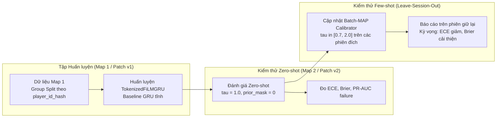

* **Zero-shot protocol:** Đánh giá nguyên trạng mô hình trên Map 2 hoặc bản cân bằng mới; khóa $\tau = 1.0$, gán `empirical_prior_mask = 0`.
* **Few-shot protocol:** Áp dụng `OnlineTemperatureCalibrator` theo giao thức Leave-Session-Out. Kỳ vọng khoa học: Hiệu chuẩn nhiệt độ làm giảm ECE và Brier, nhưng không làm thay đổi thứ hạng AUC. Nếu AUC tụt dốc, nguyên nhân là do Concept Drift đòi hỏi tinh chỉnh backbone.

---

### 7.3. Benchmark B: Chịu lỗi rụng đặc trưng (Feature-Group Dropout Robustness)

Kiểm tra độ bền vững của mô hình khi mất mát dữ liệu cảm biến:
1. Sử dụng hàm `masked_feature_dropout` để che lần lượt từng nhóm trong 4 nhóm:
   * Che nhóm `progress_tempo` (4 biến).
   * Che nhóm `vitality_error` (4 biến).
   * Che nhóm `capability_economy` (4 biến).
   * Che nhóm `human_cognitive_motor` (9 biến).
2. **Tiêu chí chấp nhận:**
   * Mô hình không crash, không xuất hiện `NaN`, đầu ra luôn nằm trong $[0, 1]$.
   * Khi mất nhóm quan trọng (ví dụ `vitality_error`), $\text{Confidence}$ phải tụt xuống dưới $0.80$ và Controller kích hoạt trạng thái giữ nguyên an toàn `HOLD_LOW_CONFIDENCE`.

---

### 7.4. Benchmark C: Khái quát hóa thăm dò Cross-Genre

* Thử nghiệm trên một mini-game thể loại khác hoàn toàn (ví dụ: chuyển từ Tower Defense sang Endless Runner hoặc 2D Action).
* Bắt buộc phải thiết lập Semantic Adapter chuyển đổi trạng thái game thành 21 tín hiệu canonical.
* **Ranh giới tuyên bố:** Báo cáo khoa học chỉ trình bày đây là nghiên cứu thăm dò tính khả thi (exploratory transferability), không khẳng định là mô hình zero-shot phổ quát (`report.md` §1.5).

---

### 7.5. Phân tích độ nhạy (Sensitivity Analysis)

Kiểm tra đạo hàm riêng hoặc độ biến thiên của xác suất dự báo theo sự thay đổi của độ khó:
$$\Delta_p = \hat p(d_{\text{cur}} - 1) - \hat p(d_{\text{cur}} + 1)$$
Một mô hình hợp lý phải có tính đơn điệu cục bộ: khi tăng độ khó, xác suất thành công phải giảm ($\Delta_p > 0$). Nếu $\Delta_p \approx 0$ trên diện rộng, mô hình đã bị thoái hóa S-learner và phớt lờ nhánh độ khó can thiệp.

---

## 8. TÍCH HỢP GAME ENGINE (UNITY / ONNX SENTIS)

### 8.1. Ràng buộc ONNX và rủi ro tương thích Unity Sentis

Mã nguồn cung cấp hàm `export_tokenized_onnx` (`models.py:196-211`) để xuất mô hình sang đồ thị tĩnh **[Đã kiểm chứng trong mã]**. Tuy nhiên, quá trình tích hợp vào Unity Sentis / Unity Inference Engine đối mặt với 2 rào cản kỹ thuật lớn:

1. **Rào cản Opset Version:**
   * Mã nguồn hiện xuất với `opset_version = 17`.
   * Runtime Unity Sentis (gói `com.unity.ai.inference`) phiên bản 1.3/2.0 chỉ hỗ trợ chính thức các mô hình trong dải **opset 7 đến 15**. Sử dụng opset 17 có nguy cơ gây lỗi không thể nhập (import error) hoặc crash bộ phân giải đồ thị.
   * **Khuyến nghị:** Hạ xuống `opset_version = 15` khi xuất bản artifact triển khai.
2. **Rào cản Toán tử `GRU`:**
   * Toán tử `nn.GRU` của PyTorch khi xuất ONNX sẽ tạo ra node `GRU` nguyên khối. Đây là toán tử nằm trong danh mục **chưa được Unity Sentis hỗ trợ đầy đủ trên mọi backend đồ họa** (WebGL, Metal, Vulkan).
   * **Phương án khắc phục kiến trúc [Khuyến nghị]:** Cài đặt lại mạng GRU dưới dạng vòng lặp trải phẳng tĩnh (Unrolled Static Loop qua 12 bước) sử dụng `nn.GRUCell` hoặc các phép tính cơ bản (`Linear`, `Sigmoid`, `Tanh`, `Mul`, `Add`). Đồ thị này được Sentis hỗ trợ 100% trên toàn bộ các nền tảng di động và console.

---

### 8.2. Phân chia trách nhiệm giữa đồ thị ONNX và mã C# Runtime

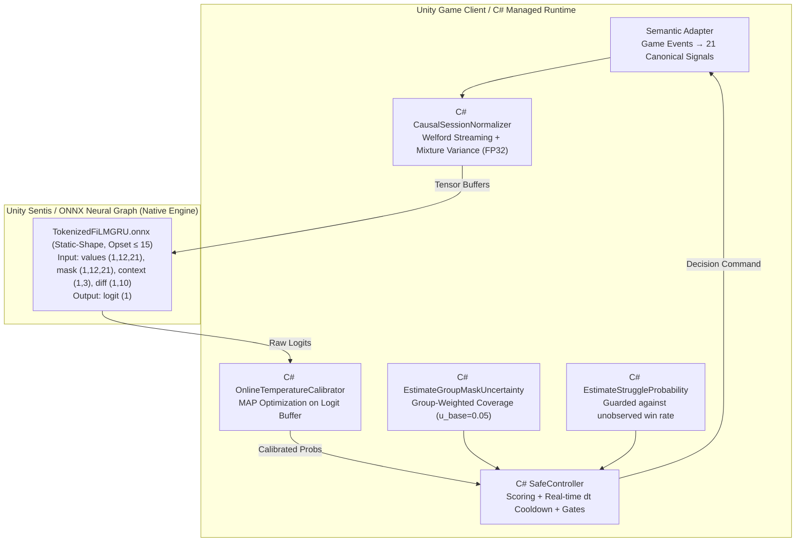

* **Phần trong ONNX:** Toàn bộ mạng nơ-ron từ Tokenizer, Masked Gated Pooling, GRU Backbone, FiLM Conditioning đến Output Head.
* **Phần trong C#:** Bộ chuẩn hóa Welford, bộ tính độ bất định, bộ tính chỉ số struggle, bộ cân chỉnh nhiệt độ MAP và bộ điều khiển an toàn. Các thành phần này chỉ gồm các phép tính số học đơn giản, thực thi trong $O(1)$ với độ trễ $< 0.1$ ms.

---

### 8.3. Mục tiêu Zero GC Alloc và ngân sách thời gian thực

* **Zero Garbage Collection (Zero GC Alloc):**
  Trong quá trình chơi game, việc cấp phát bộ nhớ động trên heap (C# Managed Heap) sẽ kích hoạt Garbage Collector, gây hiện tượng giật khung hình (frame stutter). Kiến trúc đạt Zero GC Alloc nhờ:
  - Cố định kích thước tensor đầu vào ($[1, 12, 21]$, $[1, 10]$, $[1, 3]$), cấp phát buffer tensor GPU một lần duy nhất lúc tải màn chơi.
  - Sử dụng struct C# cho `Decision`, `ControllerState` và các mảng tĩnh (fixed arrays) trong `CausalSessionNormalizer`.
* **Ngân sách thời gian trễ (Latency Budget):** Toàn bộ chu trình từ suy luận 3 ứng viên độ khó đến khi ra quyết định điều khiển phải hoàn tất trong **$< 5$ ms** trên CPU thiết bị di động tầm trung.

---

### 8.4. Dây chuyền dự phòng và định dạng Telemetry Audit Log

#### a. Dây chuyền dự phòng an toàn (Fallback Chain)

```text
Trạng thái game bình thường (đủ 12 snapshot, checkpoint an toàn)
    │
    ├── Chưa đủ 12 snapshot ban đầu (Warm-up) ─────────────> HOLD (giữ độ khó mặc định)
    ├── Thiếu cảm biến / Confidence < 0.80 ────────────────> HOLD_LOW_CONFIDENCE
    ├── Đang trong thời gian Cooldown ──────────────────────> HOLD_COOLDOWN
    ├── Không ở Safe Checkpoint (đang combat) ─────────────> HOLD_UNSAFE_CHECKPOINT
    └── Lỗi suy luận Sentis / Ngoại lệ / NaN ───────────────> HOLD (Fail-safe Invariant I7)
```

#### b. Cấu trúc bản ghi Telemetry Audit Log
Mọi quyết định của bộ điều khiển phải được ghi vào log kiểm toán để phục vụ phân tích ngoại tuyến và nghiên cứu RL:

```json
{
  "timestamp_utc": "2026-11-15T00:00:00Z",
  "session_id": "sess_8f3a1b",
  "player_id_hash": "a1c7e4...",
  "decision_time_seconds": 185.0,
  "safe_checkpoint": true,
  "current_difficulty": 2,
  "confidence": 0.871,
  "struggle_index": 0.25,
  "candidates": {
    "1": {"raw_p": 0.88, "calibrated_p": 0.85, "score": -0.215},
    "2": {"raw_p": 0.76, "calibrated_p": 0.72, "score": -0.048},
    "3": {"raw_p": 0.58, "calibrated_p": 0.54, "score": -0.233}
  },
  "streaks": {"increase": 1, "decrease": 0},
  "cooldown_remaining": 0.0,
  "decision": {
    "applied_difficulty": 2,
    "reason": "HOLD",
    "calibrator_tau": 1.15
  },
  "propensity_score": 1.0
}
```

---

## 9. TỔNG KẾT: ĐIỂM MẠNH, RỦI RO VÀ LỘ TRÌNH

### 9.1. Điểm mạnh kiến trúc cốt lõi

1. **Nguyên lý phân ly hoàn hảo:** Tách rời hoàn toàn giữa logic thích ứng trừu tượng và nghiệp vụ đặc thù của game engine thông qua 21 Canonical Signals.
2. **Thiết kế Causal-First:** Loại trừ triệt để rò rỉ thông tin tương lai ở mọi mắt xích từ tiền xử lý, chuẩn hóa Welford đến gán nhãn phân đoạn.
3. **Mạng nơ-ron Static-Shape Masked Pooling:** Giải quyết triệt để bài toán thiếu dữ liệu mà không làm thay đổi hình học tensor, tối ưu cho việc thực thi ONNX trên game engine.
4. **An toàn trải nghiệm (Safety First):** Bộ điều khiển được bảo vệ bởi 7 bất biến an toàn toán học, kết hợp vùng chết, bộ lọc chống rung lắc và thời gian hồi thực tế.

---

### 9.2. Rủi ro kỹ thuật và hạn chế hiện tại (G1–G10)

Bảng đối chiếu 10 khoảng trống triển khai giữa lý thuyết và mã nguồn:

| Mã | Khoảng trống kỹ thuật | Mức độ rủi ro | Biện pháp xử lý đề xuất |
|:---:|---|:---:|---|
| **G1** | Chưa có hàm `build_tokenized_window_rows()` trong repo | 🔴 Cao | Xây dựng script chuyển đổi khép kín từ snapshot thô sang tensor canonical v2. |
| **G2** | Pipeline tiền xử lý v1 vẫn dùng `fillna(0)` | 🟡 Trung bình | Cách ly hoàn toàn đường ống v1, chỉ dùng cho mô hình baseline so sánh. |
| **G3** | Cửa sổ v1 không sinh availability mask | 🟡 Trung bình | Đảm bảo tập dữ liệu huấn luyện v2 luôn đi kèm tensor mask chuẩn. |
| **G4** | `scripts/train_adaptive.py` chưa tính chỉ số kiểm thử | 🔴 Cao | Bổ sung module tính toán Brier, ECE, Log Loss, PR-AUC failure vào script. |
| **G5** | Hàm `_fit_temperature` offline chưa được nối pipeline | 🟢 Thấp | Tích hợp vào báo cáo so sánh giữa hiệu chuẩn offline và online. |
| **G6** | `aggregate_history` thiếu đặc trưng min/max | 🟢 Thấp | Cập nhật hàm trích xuất thống kê để đồng bộ hoàn toàn với tài liệu lý thuyết. |
| **G7** | Chưa có cơ chế Early Stopping khi huấn luyện | 🟡 Trung bình | Thêm callback dừng sớm dựa trên validation loss để chống quá khớp. |
| **G8** | `TokenizedFiLMGRU` chưa có Dropout trong khối backbone | 🟡 Trung bình | Thêm Dropout nhẹ ($0.1\text{--}0.2$) để tăng độ khái quát hóa. |
| **G9** | Lệch logit do `pos_weight` trong mã v1 | 🟢 Thấp | Khẳng định mô hình v2 không dùng `pos_weight`, bảo toàn ý nghĩa logit. |
| **G10** | Chưa có bài kiểm tra tự động Train–Serve Parity | 🔴 Cao | Bổ sung unit test kiểm chứng độ lệch đầu ra giữa streaming C# và batch PyTorch. |

---

### 9.3. Lộ trình phát triển đề xuất

```mermaid
flowchart LR
    subgraph V2["Hiện tại: DDA Runtime v2.0"]
        V2A["Universal Runtime Contract"]
        V2B["Tokenized FiLM GRU"]
        V2C["Safe Rule Controller"]
    end

    subgraph V25["Giai đoạn v2.5: Hardening & Tooling"]
        V25A["Khép kín Pipeline v2 (Bù G1-G4)"]
        V25B["Unrolled GRU cho Unity Sentis"]
        V25C["Train-Serve Parity Unit Tests"]
    end

    subgraph V3["Giai đoạn v3.0: Learned Policies"]
        V3A["Constrained Contextual Bandits"]
        V3B["Offline RL (Conservative Q-Learning)"]
        V3C["Multi-Objective Retention Optimization"]
    end

    V2 --> V25 --> V3
```

1. **Giai đoạn v2.5 (Hoàn thiện và đóng gói triển khai):**
   * Khép kín đường ống tiền xử lý v2 từ raw logs sang `(values, mask)`.
   * Cài đặt phiên bản Unrolled GRU để đạt khả năng tương thích 100% trên Unity Sentis.
   * Xây dựng bộ kiểm thử Train–Serve Parity tự động.
2. **Giai đoạn v3.0 (Học chính sách tối ưu):**
   * Thay thế bộ điều khiển rule-based bằng **Constrained Contextual Bandits** có chặn biên an toàn.
   * Nghiên cứu thuật toán **Offline Reinforcement Learning (CQL)** để tối ưu hóa trực tiếp thời lượng phiên chơi (Engagement) và độ gắn kết lâu dài của game thủ.

---

## 10. PHỤ LỤC

### 10.1. Bảng đối chiếu ký hiệu và tham số toàn hệ thống

| Ký hiệu / Tham số | Giá trị mặc định | Định nghĩa toán học / Ý nghĩa kỹ thuật | Vị trí cấu hình |
|---|:---:|---|---|
| $L$ (`sequence_length`) | 12 | Số snapshot trong cửa sổ quan sát lịch sử ($12 \times 5s = 60s$). | `data.py:210` |
| $\Delta t$ (`snapshot_interval`) | 5.0 s | Chu kỳ lấy mẫu telemetry trạng thái người chơi. | Logger contract |
| $F$ (`feature_count`) | 21 | Số lượng tín hiệu ngữ nghĩa toàn cục Canonical. | `canonical.py:9` |
| $C$ (`context_count`) | 3 | Số chiều vector ngữ cảnh (`progress`, `segment_index`, `difficulty`). | `data.py:244` |
| $D_{\text{dim}}$ (`difficulty_dim`) | 10 | Kích thước vector độ khó (5 giá trị delta + 5 mask). | `models.py:132` |
| $\kappa$ (`prior_weight`) | 10.0 | Trọng số tiên nghiệm co cụm Bayes trong chuẩn hóa. | `canonical.py:89` |
| $\sigma_{\min}$ (`min_scale`) | 0.05 | Sàn độ lệch chuẩn chống chia cho 0. | `canonical.py:90` |
| $\tau$ (`temperature`) | 1.0 | Nhiệt độ hiệu chuẩn xác suất (dao động trong $[0.7, 2.0]$). | `adaptation.py:17` |
| $B_{\text{calib}}$ (`batch_size`) | 20 | Số phân đoạn tích lũy trong buffer trước khi cập nhật $\tau$. | `adaptation.py:19` |
| $P_{\text{target}}$ | 0.70 | Xác suất thành công mục tiêu duy trì trạng thái dòng chảy. | `controller.py:27` |
| $\lambda_u$ (`uncertainty_weight`) | 0.25 | Hệ số phạt độ bất định trong hàm chấm điểm ứng viên. | `controller.py:35` |
| $\lambda_c$ (`change_weight`) | 0.05 | Chi phí thay đổi độ khó (chống đổi vặt). | `controller.py:35` |
| $T_{\text{cooldown}}$ | 60.0 s | Thời gian đóng băng sau khi thay đổi độ khó. | `controller.py:30` |
| $N_{\text{streak}}$ | 2 | Số chu kỳ liên tiếp tối thiểu để xác nhận đổi độ khó. | `controller.py:50, 54` |
| $u_{\text{base}}$ | 0.05 | Độ bất định nền khi dữ liệu cảm biến đầy đủ 100%. | `models.py:213` |

---

### 10.2. Ma trận đối chiếu ba lớp: `report.md` ↔ Kiến trúc ↔ Mã nguồn

| Khái niệm nghiệp vụ | Cơ sở lý thuyết (`report.md`) | Đặc tả kiến trúc (Tài liệu này) | Triển khai mã nguồn thực tế |
|---|---|---|---|
| **Causal Boundary** | §1.4, §3.1 (Cô lập ranh giới nhân quả) | §3.3, §6.1 | `segments.py:32-47`, `data.py:210-247` |
| **21 Canonical Features** | §2.1 (Tín hiệu ngữ nghĩa chuẩn) | §4.1, §5.1 | `canonical.py:9-16`, contract JSON |
| **Bayesian Shrinkage** | §2.6 (Welford + phương sai hỗn hợp) | §5.1 | `canonical.py:85-134` (`CausalSessionNormalizer`) |
| **Masked Gated Pooling** | §4.3 (Attention mềm có biên chặn) | §5.2 | `models.py:156-159` (`clamp_min(1e-6)`) |
| **FiLM Conditioning** | §4.4 (Điều chế tuyến tính trạng thái ẩn) | §5.2 | `models.py:162-163` (`gamma`, `beta`) |
| **Batch-MAP Calibrator** | §5.2 (Nội suy MAP trên logit buffer) | §5.3 | `adaptation.py:6-60` (`OnlineTemperatureCalibrator`) |
| **Group-Weighted Confidence** | §5.3 (Độ tin cậy theo độ phủ 4 nhóm) | §5.4 | `models.py:213-240` (`estimate_mask_uncertainty`) |
| **Guarded Struggle Index** | §5.4 (Chỉ số khó khăn heuristic) | §5.4 | `models.py:243-255` (`estimate_struggle_probability`) |
| **Dead Band + Debounce** | §6.4 (Vùng chết và lọc nhiễu liên tiếp) | §5.5 | `controller.py:44-58` (`decide`) |
| **Player Group Split** | §3.2 (Phân chia độc lập người chơi) | §6.2 | `train.py:13-26` (`group_split`) |
| **Failure PR-AUC** | §5.1 (Nghịch đảo lớp dương thiểu số) | §7.1 | `train.py:68` *(Khoảng trống G4 cần đảo nhãn)* |
| **ONNX Static Export** | §8.1 (Xuất đồ thị tĩnh cho game engine) | §8.1 | `models.py:196-211` (`export_tokenized_onnx`) |

---

### 10.3. Danh sách kiểm tra và xác minh (Verification Checklist)

Trước khi đóng băng kiến trúc hoặc đưa vào thử nghiệm sản phẩm, nhóm nghiên cứu cần hoàn thành danh sách kiểm tra sau:

- [x] Vector độ khó đầu vào được đồng bộ chính xác **10 chiều** (`5 values + 5 mask`).
- [x] Gated Pooling sử dụng cận dưới `clamp_min(1e-6)` chống teo biên độ.
- [x] Phương sai co cụm Bayes tích hợp đầy đủ số hạng phương sai hỗn hợp $w(1-w)(\mu_g - \mu_s)^2$.
- [x] Bộ chuẩn hóa Welford chỉ cập nhật khi `mask == 1.0`.
- [x] Cooldown Controller trừ theo thời gian thực `dt_seconds` giữa hai lần đánh giá.
- [x] Bộ lọc dữ liệu thiếu phân biệt rõ giữa đứt gãy thời gian ($>35\%$) và thiếu nhóm đặc trưng.
- [x] `normalized_segment_index` thay thế hoàn toàn biến đặc thù `wave_normalized`.
- [x] Độ phủ mặt nạ tính theo trung bình 4 nhóm nghiệp vụ $\times 25\%$ (Group-Weighted).
- [x] Chỉ số khó khăn có cờ kiểm tra khả dụng chống bẫy giá trị giữ chỗ đầu trận.
- [ ] Bổ sung script sinh dữ liệu cửa sổ v2 `build_tokenized_window_rows()` (Khắc phục G1).
- [ ] Đảo nhãn lớp dương trong hàm tính PR-AUC của `train.py` sang Failure ($y=0$) (Khắc phục G4).
- [ ] Hạ `opset_version` xuống $\le 15$ và kiểm thử unrolled GRU trên Unity Sentis (Khắc phục §8.1).
- [ ] Thực hiện bài kiểm tra Train–Serve Parity giữa mã C# và Python (Khắc phục G10).

---

### 10.4. Các lệnh kiểm thử và kiểm chứng nhanh

Chạy toàn bộ bộ kiểm thử đơn vị của hệ thống:
```bash
python -m unittest discover -s tests -v
```

Kiểm tra tính toàn vẹn cú pháp của toàn bộ gói mã nguồn:
```bash
python -c "import py_compile, glob; [py_compile.compile(f, doraise=True) for f in glob.glob('src/ddamodels/*.py')]; print('All modules compiled successfully!')"
```

Kiểm chứng số học logic bất định và chỉ số struggle:
```bash
python -c "from ddamodels.models import estimate_mask_uncertainty, estimate_struggle_probability; print('Uncertainty & Struggle modules verified!')"
```
